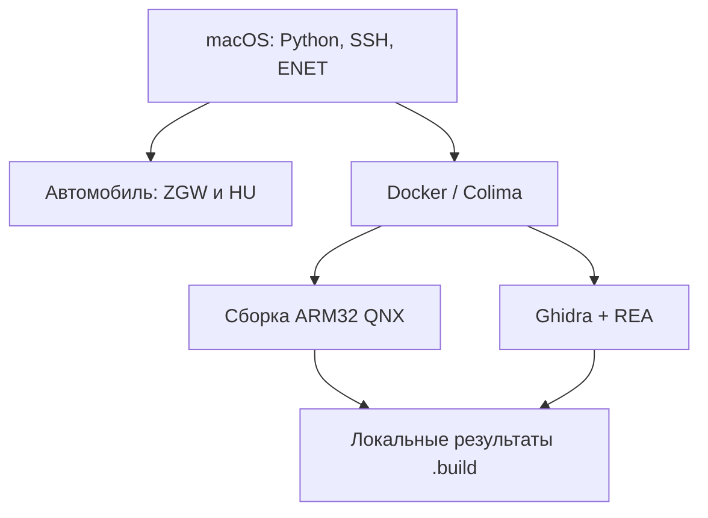

# NBT Evo: нативные приложения и исследование HU

Исследование BMW NBT Evo / iDrive 6: доступ к HU, сборка ARM32 QNX, анализ библиотек, HMI и взаимодействие с KOMBI. Кодирование и обновление ПО выделены в отдельные направления.

Основные документы:

- [Рабочий план и журнал достижений](docs/software/nbt-evo/plan.md).
- [База знаний: протоколы, API, проекты и источники](docs/software/nbt-evo/knowledge-base.md).
- [Навигация по кодированию, обновлениям и исследованиям](docs/software/README.md).
- [Контекст тестового автомобиля](docs/vehicle/BMW_F21_N13B16_SPECS.md).



На Mac используются Python 3.11+, Git и работающий Docker. Компилятор QNX, Java, Node и Ghidra работают в контейнерах. Сетевые проверки автомобиля выполняются с Mac. Анализ и тестовая сборка работают без сети после подготовки зависимостей.

Проверка кода:

```sh
python3 -m unittest discover -s tools/tests -v
python3 tools/check_public.py
```

Подготовка Ghidra/REA при наличии интернета:

```sh
python3 tools/nbt_re.py init
python3 tools/nbt_re.py prepare
python3 tools/nbt_re.py build
python3 tools/nbt_re.py doctor
```

Для QNX нужны отдельные локальные входные файлы; клонирование репозитория само по себе их не устанавливает. Порядок подготовки и ограничения ABI описаны в базе знаний. Общий bootstrap и переносимый офлайн-комплект пока запланированы.

## Что уже проверено

Сборка тестовых C/C++98 программ в ARM32 QNX ELF и анализ собственного тестового ELF в Ghidra. Диагностические ответы автомобиля собраны; успешный SSH-вход и запуск нашей программы на HU **ещё не подтверждены**.

## Публичные и локальные материалы

Проект выделен из частного clubsport 2026-11-17 с новой историей Git. Планы, инструменты и обезличенные журналы опубликованы здесь. VIN и MAC в опубликованных журналах заменены синтетическими значениями; это производные копии, не исходные захваты. Исторические имена Docker-образов в журналах сохранены; текущие команды используют префикс `nbt-evo`.

SDK, лицензии, сторонние бинарные пакеты, файлы HU, оригиналы журналов и конфигурация сеанса хранятся только локально в игнорируемых каталогах `private/`, `.build/`, `tools/qnx/`, `tools/qnx-deps/` и `config/nbt/*.local.json`. Они не входят в публичный clone. Сторонние проекты остаются собственностью их авторов; их условия лицензирования действуют отдельно.
