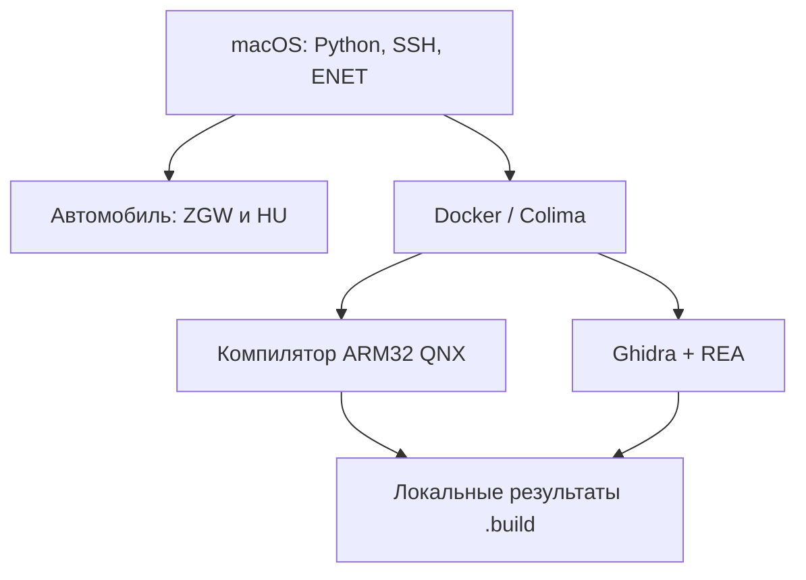

# NBT Evo

Инструменты для BMW NBT Evo / iDrive 6: диагностика ENET, сборка ARM32 QNX и локальная работа с Ghidra/REA.

В Git публикуются проверенные факты, работающий код, тесты, рецепты окружения и инструкции по их использованию.

- [Подтверждённые результаты и границы проверок](docs/facts.md).
- [Архитектура, подготовка и команды инструментов](docs/environment.md).
- [Обезличенные отчёты проверок](docs/evidence/).



Развёртывание окружения на подготовленном Mac с Docker и Ansible:

```sh
./tools/nbt-env fetch
./tools/nbt-env setup
```

fetch показывает ход загрузок, скорость и ETA архивов; setup использует проверенные локальные ресурсы.

Повторная проверка окружения: `./tools/nbt-env check`. Параметры и порядок работы описаны в [инструкции](docs/environment.md#загрузка-ресурсов-и-развёртывание-через-ansible).

Проверка кода из корня проекта:

```sh
python3 -m unittest discover -s tools/tests -v
python3 tools/check_public.py
```
