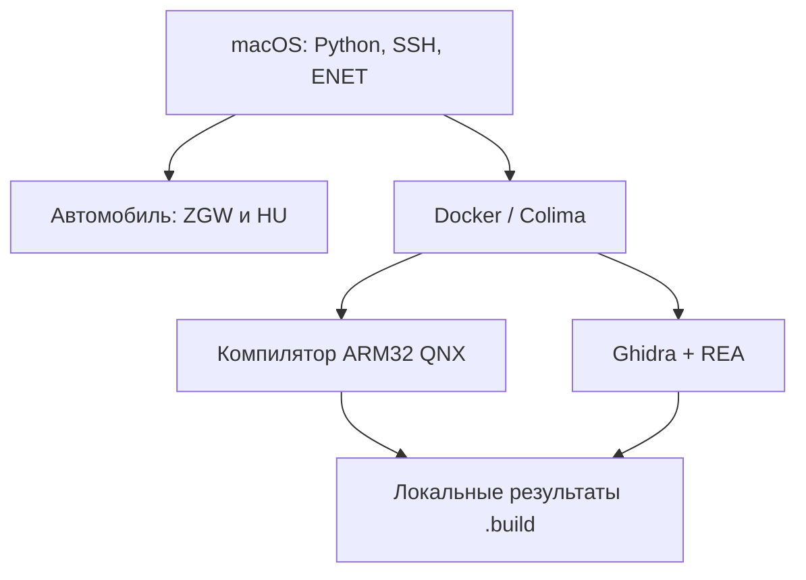

# NBT Evo

Инструменты для BMW NBT Evo / iDrive 6: диагностика ENET, сборка ARM32 QNX и локальная работа с Ghidra/REA.

В Git публикуются проверенные факты, работающий код, тесты, рецепты окружения и инструкции по их использованию.

- [Подтверждённые результаты и границы проверок](docs/facts.md).
- [Архитектура, подготовка и команды инструментов](docs/environment.md).
- [Обезличенные отчёты проверок](docs/evidence/).



Быстрая проверка из корня проекта:

```sh
python3 -m unittest discover -s tools/tests -v
python3 tools/check_public.py
```
