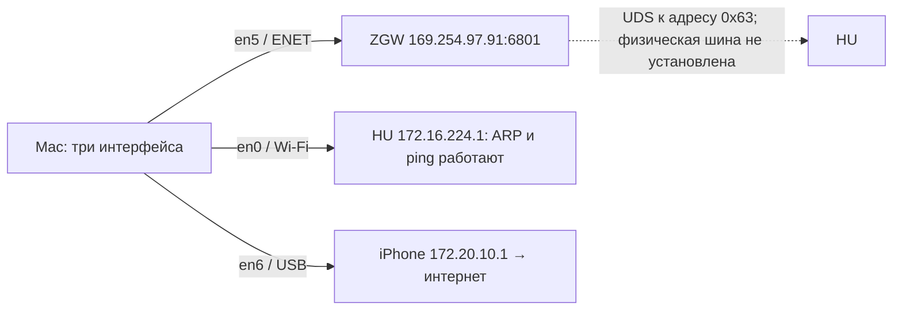
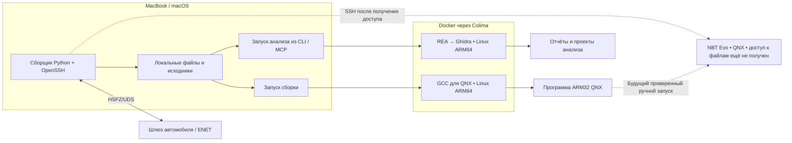

# База знаний NBT Evo, ENET и диагностика BMW F21

> Версия: 2026-11-17. Область: BMW F21 N13B16 из досье, обследование через ENET и разработка автономных функций для предполагаемого HU_NBT_EVO. Это справочник по протоколам и инструментам. Порядок работ вынесен в [план на автомобиле](plan.md).

[Раздел ПО автомобиля](../README.md)

Статусы: `confirmed` — подтверждено в досье или проверено непосредственно с указанным охватом, `measured` — получено измерением, `reported` — описано источником, `planned` — запланировано, `unknown` — для нашего автомобиля не установлено. На 2026-11-16 выполнены discovery реальной машины и проверка TCP 6801; прочитаны идентификаторы ECU и IP HU; доступ к ОС HU и автомобильные параметры ещё не проверены.

### Разрешённые подключения и запросы, правило от 2026-11-16

`confirmed`, явное указание владельца: на нашем F21 разрешены подключения и активная передача пакетов/запросов в автомобильную сеть для диагностики, исследования и разработки. Для обнаружения, проверки протокола, идентификации и диагностических чтений не нужен предварительный стенд или повторное подтверждение каждого запроса. Это относится и к HU по Wi-Fi, и к ENET/HSFZ/UDS. Проверяем адресата/интерфейс, ограничиваем частоту и тайм-ауты, сохраняем результаты.

Прошивка, кодирование, запись параметров/конфигурации ECU, исполнительные команды и отключение защит требуют явной авторизации именно этих работ и подготовки проверки/восстановления. Ранее авторизованное временное открытие SSH не требует повторного разрешения только из-за сетевого обмена. Полное действующее правило — [AGENTS.md](../../../AGENTS.md). Старые записи об обязательном стенде или отказах автоматической проверки ниже описывают историю, а не текущий запрет на активные чтения.

## 1. Карта интерфейсов

| Интерфейс | Назначение | Статус для F21 |
|---|---|---|
| OBD → Ethernet → HSFZ → UDS | Mac обнаруживает диагностический шлюз и адресует запросы ECU | `measured`: discovery нашего F21 и TCP 6801 работают; UDS-ответы ZGW/HU/KOMBI получены, см. результаты первого сеанса |
| PT-CAN → DataTrack CAN1 | Пассивная запись кадров и расчёт параметров по карте | Установка `confirmed`; карта декодеров `reported` |
| Штатные данные HU → CDS/Etch → клиент BMW Apps | Подписка внешнего клиента на часть параметров, которые предоставляет HU | `reported` по BimmerGestalt; наличие, поля и частота на F21 `unknown` |
| Клиент BMW Apps → RHMI → CID | Штатный экран рисует интерфейс клиента и возвращает события управления | `reported` по AAIdrive; применимость к нашему HU `unknown` |
| Локальный процесс на HU → внутренние сервисы/HMI | Целевой путь для автономной программы | Отладочный доступ показан на отдельных версиях (`reported`); API, ABI и доступ на F21 `unknown` |
| HU → KOMBI/HUD | Отдельный канал для штатной навигационной индикации | Показан на совместимых конфигурациях (`reported`); тип нашей KOMBI и телеметрический вывод `unknown` |

CID — центральный экран, KOMBI — приборная панель, HUD — проекция, HU — головное устройство. Диагностический Ethernet через OBD и пассивный захват CAN требуют разных источников. Доступ к шлюзу по ENET сам по себе не открывает внутренние API HU.

## 2. Диагностический транспорт и идентификация

### ENET и HSFZ

- `reported`: HSFZ discovery использует UDP 6811. Запрос идентификации — `00 00 00 00 00 11`. В ответе могут быть диагностический адрес, MAC и VIN. Для прямого линка часто используется IPv4 link-local `169.254/16`. При modBM сеть и broadcast определяются настройками DHCP; при отсутствии discovery проверить IP автомобиля в DHCP leases.
- `reported`: диагностический канал HSFZ использует TCP 6801. Заголовок — 4 байта длины и 2 байта типа в big-endian. В кадре типа `0x0001` длина включает байты адресов источника и получателя, затем UDS. `0x0002` — транспортное подтверждение, `0x0011` — идентификация, `0x0012` — alive check. TCP может разделять один кадр или склеивать несколько.
- `reported`: DoIP использует другую инкапсуляцию UDS, со своими discovery и routing activation. Для текущего скрипта реализован HSFZ. Поддержку DoIP конкретным блоком не предполагаем. См. [HSFZ в rawenet](https://github.com/rawmind0/rawenet/blob/master/docs/hsfz-protocol.md), [реализацию DoIP в Scapy](https://github.com/secdev/scapy/blob/master/scapy/contrib/automotive/doip.py), [modBM](https://www.modbm.com/wiki/index.php/ModBM_WIFI_ENET).

### Первый ответ нашего F21, 2026-11-16

`measured`: ENET на Mac — **en5**, локальный адрес **169.254.137.164/16**, линк 100baseTX full-duplex. Один стандартный discovery UDP 6811 получил ответ от **169.254.97.91**, payload `DIAGADR10BMWMAC020000000001BMWVINWBA00000000000000`; VIN совпадает с досье. Маршрут к адресу проходит через en5; TCP-подключение к **6801** успешно. [Результат проверки](../../../logs/nbt-evo/2026-11-16-enet-discovery.json).

Это адрес **диагностического шлюза** в текущем сеансе. SSH-адрес HU, её ОС и firmware остаются `unknown`. После переподключения повторять discovery, не считать IP постоянным. UDS-идентификация в этой проверке не выполнялась; кодирование/запись настроек не выполнялись.

### Запросы в нашем клиенте

| Цель | Адрес HSFZ | DID | Что ищем |
|---|---|---|---|
| ZGW | `0x10` | `0x100B` | VCM Integration Step |
| HU | `0x63` | `0xF187`, `0xF189`, `0xF101` | Номер детали, версия ПО, SVK |
| KOMBI | `0x60` | `0xF187`, `0xF189`, `0xF101` | Номер детали, версия ПО, SVK |

Это фиксированные цели реализации (`confirmed` по коду). На 2026-11-16 F101 HU/KOMBI и 100B ZGW прочитаны; F187/F189 HU/KOMBI возвращают NRC 0x31. Клиент использует адрес тестера `0xF4` и UDS ReadDataByIdentifier (`0x22`). Положительный ответ начинается с `62 <DID>`, отрицательный — `7F 22 <NRC>`. `0x78` означает ожидание завершения, `0x31` — запрос вне допустимого диапазона. Код отказа сохраняем вместе с DID. Успешное чтение отдельного SVK не гарантирует полный SVT Actual.

HWEL — идентификатор аппаратной части, BTLD — загрузчика, SWFL — программного образа, CAFD — данных кодирования. SVK содержит идентификаторы ПО блока. SVT описывает состав и программные варианты блоков автомобиля. I-Step — уровень интеграции. Строка `NBTevo_…` из меню полезна как дополнительная привязка к версии. См. [BMW DID/SVK в Scapy](https://github.com/secdev/scapy/blob/master/scapy/contrib/automotive/bmw/definitions.py), [автономный клиент](../../../tools/enet_identify.py).

### Идентификаторы и IP HU нашего F21, 2026-11-16

`measured`: [исходные ответы и декодированные SVK](../../../logs/nbt-evo/2026-11-16-enet-identification.json). Разбор восьмибайтовых записей по [схеме Scapy](https://github.com/secdev/scapy/blob/master/scapy/contrib/automotive/bmw/definitions.py#L253-L335), количество записей и длины проверены; служебный префикс/даты не интерпретировались.

| Блок | HWEL | BTLD | CAFD |
|---|---|---|---|
| HU, 0x63, 19 записей SVK | 00002fc3 / 001.004.001 | 00001ffd / 007.030.001 | 00001ef6 / 006.052.007 |
| KOMBI, 0x60, 12 записей SVK | 000010f7 / 002.001.113; 000009c6 / 002.001.010 | 00001107 / 002.006.114 | 000009c8 / 006.000.031 |

У HU десять SWFL-записей версии 007.030.001; полный перечень в JSON. Точный тип KOMBI (6WA/6WB), номера деталей, ОС и бинарная совместимость HMI этим не установлены. DID F187/F189 обоих блоков вернули **NRC 0x31**; это не потеря связи. DID ZGW 100B сохранён сырым, I-Step пока не декодирован.

`reported`: владелец прочитал в меню **X20511I**; в конфиге записано **NBTevo_X20511I** с добавленным префиксом для единообразия. Чтения строки firmware из файлов HU ещё не было.

`measured`: чтение HU DID **0x172A** вернуло формат 0, **169.254.199.99**, маску **255.255.0.0**, gateway **0.0.0.0**. HU сначала присылает `7F 22 78` (responsePending): два чтения с ожиданием 3 секунды не получили окончательный ответ, запрос с общим ожиданием 15 секунд получил `62 17 2A`. Точное время ответа не измерялось. [Кадры и декодирование](../../../logs/nbt-evo/2026-11-16-hu-ip-15s.json). При добавлении этого чтения в автоматизацию нужен отдельный увеличенный тайм-аут; текущий collector его пока не выполняет.

**Прямая связь с HU не установлена.** Общий маршрут Mac сначала выбирал en0/Wi-Fi. Повторный сокет привязан к en5 через Darwin IP_BOUND_IF (значение 25 проверено по локальному SDK netinet/in.h) и адресу 169.254.137.164; TCP 22 также завершился тайм-аутом. После проверки ARP для HU — `(incomplete)` на en5. Это граница на уровне доступности сети; нельзя утверждать, что доказано отключение SSH. [Проверка en5](../../../logs/nbt-evo/2026-11-16-hu-ssh-en5.json). Контрольное чтение F101 через шлюз успешно после первого тайм-аута, то есть диагностический путь продолжал работать. Маршруты Mac, настройки HU, сессии программирования, аутентификация SSH и файлы HU не изменялись.

Локальный приватный конфиг дополнен en5, IP HU и reported firmware. Collector перед SSH проверяет маршрут и остановится при выборе неправильного интерфейса; фактический маршрут надо сверять заново. Следующий этап — выяснить условия Ethernet-доступа к HU на данной firmware и способ восстановления до любых изменений. Из ARP incomplete нельзя выбрать между состоянием питания, топологией/маршрутизацией и ограничениями доступа.

### Временный SSH и фактическая сеть после клиента, 2026-11-16

`reported` владельцем: двигатель заведён, зажигание включено, iDrive работает и реагирует на контроллер. Состояние сна не принимаем за установленную причину сетевого тайм-аута.

Подготовлен официальный [Bavarian SSH Client](https://ssh.bavarian-aa.uk/) для macOS ARM64. Архив 2 397 601 байт, SHA-256 `d2e706e22b9f880f55ffc86ad116acc43eeac2d5c2883bfc4072c0e186a0b5fb` совпал со страницей и SHA256SUMS издателя. Пакет хранится локально в `.build/nbt-qnx/access/`, переносимое приложение — `clean/bavarian-ssh-client.app`; в Applications не устанавливалось. Чистая распаковка ZIP проходит codesign verify, подпись ad-hoc, TeamIdentifier отсутствует. Первая распаковка ditto получила FinderInfo, из-за которого strict verify не проходил; чистая распаковка без этих метаданных прошла проверку, без отключения защит macOS.

Страница издателя заявляет временное открытие SSH до перезагрузки без сохранения изменений (`reported`, независимо не проверено). У страницы есть changelog 0.2.0, но полученный официальный macOS bundle помечен 0.1.0 и показывает интерфейс только с Enable SSH. Повторная загрузка с Cache-Control no-cache и отдельным URL-параметром дала тот же SHA-256 и bundle 0.1.0; это не только старая локальная копия. **Расхождение версии зафиксировано, его связь с ошибкой не установлена.** [Метаданные и наблюдения UI](../../../logs/nbt-evo/2026-11-16-bavarian-client.json).

Во время наблюдаемого UI-сеанса клиент обнаружил правильный шлюз/VIN, со второй попытки подключился, сообщил `Gate: open`, `SSH: enabled` и IP HU 169.254.199.99. Затем вывел **`malformed relay message: unknown server tag 0x84`**, после чего `Done - SSH enabled`. Это `confirmed` как текст UI, **не** доказательство работающего SSH.

`measured`: два независимых TCP-подключения к HU:22 с IP_BOUND_IF=en5 после сообщения клиента завершились тайм-аутом. [Первая проверка](../../../logs/nbt-evo/2026-11-16-hu-ssh-after-client.json), [повтор](../../../logs/nbt-evo/2026-11-16-hu-ssh-after-client-repeat.json). ARP остаётся incomplete; общий маршрут в этот момент уже указывал en5 с временным REJECT после неудачного ARP. После операции клиента F101 HU по шлюзу по-прежнему читается, F186 вернул сырые `01 81`: [контроль](../../../logs/nbt-evo/2026-11-16-hu-after-client-control.json). DiagnosticSessionControl не отправляли. Входа в ОС, чтения uname и библиотек пока нет.

Клиент в UI подключался к внешнему серверу; локальные строки бинарника содержат `wss://pretzel.bavarian-aa.uk:8443`. Это свидетельство использования сервера в данном сценарии, не аудит протокола/состава переданных данных. **Офлайн-включение SSH этим клиентом не установлено**; готовность офлайн-сборки и локального ENET-сбора от этого не меняется.

Отдельный [evocode](https://github.com/FreZZZeR/evocode/blob/main/docs/root-access.ru.md) описывает постоянное включение OPT_DEBUG через диагностическую загрузку изменённого starter.cfg; автор отмечает ограничения аппаратной проверки. Этот путь отличается от заявления Bavarian о временном доступе. Он не запускался: его нельзя подставлять вместо неработающего временного доступа на единственной HU без проверки совместимости, восстановления и предусмотренного проектом стенда.

Следующий проверяемый шаг — устранить ошибку/несоответствие официального клиента либо получить документированный способ прямого Ethernet-доступа для точной HU. Перед следующей попыткой: сохранить текущие диагностические данные, сверить пакет/версию клиента и подтверждение поддержки X20511I, затем повторить en5/ARP/TCP-проверку. Само повторное нажатие Enable SSH, постоянный OPT_DEBUG и перезагрузка пока не обоснованы результатами. Причина недоступности HU (Ethernet-путь/ограничение доступа/эффект ошибки клиента) остаётся `unknown`.

### Приоритетная гипотеза: Ethernet-проводка ретрофита, 2026-11-16

Уточнение владельца 2026-11-16 (`reported`): до установки NBT Evo стоял ENTRY_BASIS, при ретрофите также установлены расширенная приборка/MOST и выполнены кодировки. Название прежней HU само по себе не определяет наличие/отсутствие Ethernet в исходном жгуте: нужны точные компоненты и схема конкретного F21. Работа оптики/приборки и диагностических чтений не доказывает физический Ethernet-путь до новой HU. [Инструкция офлайн-осмотра](plan.md#офлайн-проверка-ethernet-проводки-после-entry_basis--nbt-evo) включена в действующий план; распиновку другого автомобиля не использовать для перестановки контактов.

В [первичном отчёте владельца F10](https://github.com/Sq00ky/Supra-iDrive6-Android-Auto/issues/139#issuecomment-6748566542) описан практически тот же набор симптомов: ZGW отвечает, Bavarian сообщает Gate open / SSH enabled, HU не отвечает на ARP на .99 и .119; маршруты через ZGW также не помогли (`reported`, чужая машина). [Автор работающего ретрофита F11](https://github.com/Sq00ky/Supra-iDrive6-Android-Auto/issues/139#issuecomment-6748718241) сообщает, что для доступа через ZGW перенёс четыре Ethernet-провода из Quadlock в отдельный разъём HU, называемый в обсуждении OABR. В следующем обсуждении он по фото отмечает незадействованный разъём у другой машины.

**Это не установленная неисправность нашего F21**, но конкретное объяснение, которое надо проверить до повторных разблокировок и смены firmware. Успех UDS через шлюз сам по себе не доказывает наличие прямого Ethernet до HU; фактическая шина от шлюза к HU в нашей проверке не установлена. Оптика HU–KOMBI также не подтверждает путь ENET–HU.

[Фото и номера из примера F1x](https://github.com/Sq00ky/Supra-iDrive6-Android-Auto/issues/139#issuecomment-6749209993): 61139230105 — контакт, 61138709112 — корпус (`reported` автором). Применимость этих деталей, цвета проводов и распиновка к нашей HU/F21 **unknown**. Не переносить схему F1x без идентификации HU, разъёмов и заводской схемы именно F21. Термин OABR здесь используется как обозначение разъёма из обсуждения; он не устанавливает физический стандарт линии или необходимость конвертера для нашего автомобиля.

Дополнительные проверки на нашей машине (`measured`):

- [DID 4031 ZGW](../../../logs/nbt-evo/2026-11-16-ethernet-status-reads.json), EthernetStatusInformation: `01 01 01`; DID 3F17, VcmEcuListEthernet: `00 01 10`. У HU 4031 вернул NRC 31. Названия взяты из Scapy; **побайтовый формат ответов не подтверждён**, не выдавать их за измерение Ethernet-линка или доказательство отсутствия HU.
- [Адрес 169.254.199.119:22](../../../logs/nbt-evo/2026-11-16-hu-ssh-alternative-ip.json), прямо приведённый в инструкции NBT-AAD, также недоступен с en5.
- [Повторный discovery после клиента](../../../logs/nbt-evo/2026-11-16-discovery-after-unlock.json), сокет привязан к en5, окно ожидания 8 секунд: ответил только ZGW 169.254.97.91.
- IPv6 multicast ff02::1%en5 получил только два ответа **самого Mac** (адрес совпал с ifconfig en5); HU по IPv6 не обнаружена. Отсутствие ответа не доказывает отсутствие провода.

`reported` владельцем: беспроводной CarPlay работает; установку выполнял другой человек, подключение Ethernet-разъёма неизвестно; в iDrive не найдено меню с Wi-Fi SSID/паролем. CarPlay подтверждает наличие рабочего беспроводного канала для телефона, **не** доступность SSH на нём. В исходниках NBT-AAD [CarPlay AP обычно uap0/172.16.224.1](https://github.com/Sq00ky/Supra-iDrive6-Android-Auto/blob/87fd9624f33f7ec02d812ebec02a416a3875a320/milestone-7/readme.md); этот адрес нашей HU не измерен и с Mac не проверялся, поскольку Mac к BMW Wi-Fi не подключён. Не посылать запросы в чужую/VPN-сеть только по совпадению частного диапазона.

**Ближайшая развилка:** визуально проверить задние разъёмы HU и наличие Ethernet-проводов/адаптера ретрофита. Осмотр/отсоединение выполнять после остановки двигателя и выключения питания, не на работающей машине. По фото и маркировке выбрать схему для конкретного блока; сначала восстановить/подтвердить Ethernet-путь, затем повторить ARP → TCP 22 → SSH uname. Альтернатива без разбора — Wi-Fi, только если удастся штатно получить данные подключения и подтвердить, что SSH слушает эту сеть. [Сводка источников и ограничений](../../../logs/nbt-evo/2026-11-16-access-path-review.json).

### Карта трёх сетей: ENET, Wi-Fi HU, USB-модем, 2026-11-16

`measured`: [сводка адресов и результатов](../../../logs/nbt-evo/2026-11-16-network-topology.json). Адреса относятся к текущему сеансу; en5 после переподключения сменил 169.254.137.164 на 169.254.245.198.

| Сегмент | Подсеть | Mac | Другая сторона | Что проверено |
|---|---|---|---|---|
| ENET | 169.254.0.0/16 | en5: 169.254.245.198 | ZGW: 169.254.97.91 | Discovery с правильным VIN, TCP 6801 и диагностические ответы HU/KOMBI |
| Wi-Fi HU | 172.16.224.0/24 | en0: 172.16.224.117 | HU/AP/DHCP: 172.16.224.1 | ARP и 2/2 ICMP-ответа; TCP 22/23/8000 — тайм-аут |
| iPhone USB | 172.20.10.0/28 | en6: 172.20.10.4 | iPhone: 172.20.10.1 | DHCP и scoped default через en6; владелец подтвердил интернет одновременно с BMW Wi-Fi |



HU имеет **проверенный Wi-Fi IP 172.16.224.1** и **IP 169.254.199.99, возвращённый диагностическим чтением сетевой конфигурации**. Второй лежит в той же /16, что ENET Mac и ZGW, но прямая достижимость этого интерфейса HU не установлена. Не рисуем неподтверждённый физический Ethernet-провод ZGW–HU сплошной линией. Отдельные интерфейсы одного устройства могут иметь адреса в разных подсетях.

Для обращения Mac → 172.16.224.1 **не нужен маршрутизатор между Wi-Fi и ENET**: у Mac уже есть собственный адрес в Wi-Fi-подсети HU. Ping прошёл по этому пути, а SSH не отвечает; само различие подсетей не объясняет отказ SSH. Не включались Internet Sharing, IP forwarding или мост между сетями.

### Приоритет USB и повторная проверка SSH после перезапуска

Порядок служб Mac был Belkin USB-C LAN → Thunderbolt Bridge → Wi-Fi → iPhone USB. iPhone USB перемещён первым, относительный порядок остальных сохранён. Владелец подтвердил, что теперь интернет работает с подключённой Wi-Fi HU. Существующий VPN остаётся включён: общий default показывает ipsec0, scoped default для iPhone — en6/172.20.10.1. Это изменение **на Mac**, не кодирование автомобиля.

Применённая команда:

```sh
networksetup -ordernetworkservices "iPhone USB" "Belkin USB-C LAN" "Thunderbolt Bridge" "Wi-Fi"
```

Возврат прежнего порядка при необходимости:

```sh
networksetup -ordernetworkservices "Belkin USB-C LAN" "Thunderbolt Bridge" "Wi-Fi" "iPhone USB"
```

Автоподключение к BMW без передачи пароля в команду вернуло ошибку -3900; владелец подключил Mac вручную. Пароль из присланного скриншота не сохранялся в Git. Снимок с паролем не копировался в репозиторий.

Владелец подтвердил перезапуск HU во время паузы и повторно выполнил Enable SSH. UI снова сообщил Gate open / SSH enabled, затем unknown server tag 0x84. После этого Wi-Fi HU:22/23/8000 и ENET HU:22 по-прежнему дали тайм-аут. [Wi-Fi после Enable](../../../logs/nbt-evo/2026-11-16-hu-wifi-after-enable.json), [ENET после Enable](../../../logs/nbt-evo/2026-11-16-hu-enet-after-reenable.json). Отключение Wi-Fi на CarPlay-iPhone сохранило Wi-Fi Mac и USB-модем, но SSH:22 также не ответил: [контроль](../../../logs/nbt-evo/2026-11-16-hu-wifi-phone-disconnected.json). До аутентификации и проверки пароля SSH не дошли.

Внешний сервер клиента pretzel.bavarian-aa.uk:8443 доступен: DNS разрешился, оба полученных IPv4 приняли TCP и TLS 1.3 с проверкой сертификата. [Проверка](../../../logs/nbt-evo/2026-11-16-bavarian-server-connectivity.json). Это не тест полного WebSocket/relay-протокола; временное ожидание Connecting to server не доказывает блокировку сервера или неисправность VPN. Ошибка 0x84 не связана с отсутствием TCP/TLS-доступа в данной проверке, но её роль в открытии SSH остаётся неизвестной.

**Поле Car IP в Bavarian и адрес Wi-Fi HU.** По предоставленным владельцем логам клиент сначала делает `Connecting to the car at <Car IP>:6801`, то есть использует поле как диагностическую точку входа HSFZ, а адрес HU запрашивает позже. Это не поле адреса SSH:22. HU могла бы служить такой точкой входа напрямую, если бы принимала TCP 6801 на выбранном интерфейсе. На нашей машине `172.16.224.1:6801` с сокетом, привязанным к en0/172.16.224.117, завершился тайм-аутом за 4 секунды (`measured`); [результат](../../../logs/nbt-evo/2026-11-16-hu-wifi-6801-connect.json). Поэтому текущие данные не подтверждают, что замена Car IP с рабочего шлюза 169.254.97.91 на Wi-Fi IP исправит подключение. Проверялось только TCP-соединение, прикладные байты не отправлялись. Дополнительный F101 через Wi-Fi автоматическая проверка тогда отклонила со ссылкой на прежнее правило проекта о стендовой проверке передач; запрос не выполнен. Позднее 2026-11-16 владелец отменил обязательность стенда для подключений и диагностических чтений; см. действующее правило в начале справочника.

Итог: **прямой сетевой путь к HU по Wi-Fi подтверждён, SSH на нём — нет**. Фильтрация, состояние/привязка sshd и результат отладочной активации пока не различены. Осмотр Ethernet-проводки остаётся отдельным ближайшим шагом для доступа через ENET; недостающая проводка не считается установленным фактом.

### Feature Installer и альтернативы открытия SSH, 2026-11-16

**Решение владельца от 2026-11-16: Feature Installer исключён из рабочего плана.** Разбор ниже оставлен как справочная история; загрузка, приобретение кода и активация через него не планируются.

Область: оценка инструментов для нашей NBTevo_X20511I; установка и активация не выполнялись. Коммерческий Feature Installer не смешивать с установщиком ID6 Apps, Bavarian SSH Client или разными ENET-forwarder программами.

**Что это:** сторонний клиент Certificate Services LLC / HU Engineering Tools для применения кодов активации функций BMW HU через ENET. [Производитель](https://www.certificateservices.net/) публикует программу для CIC/NBT/EVO и указывает необходимость ENET. Программа и код операции — разные составляющие: поставщик выдаёт код, клиент идентифицирует машину и выполняет предусмотренные этим кодом действия. Среди продаваемых функций есть SSH, CarPlay/FSC, полноэкранный режим и другие активации (`reported` поставщиками); это не универсальный диагностический экран и не среда сборки нативных приложений.

**macOS существует.** На 2026-11-16 производитель объявляет поддержку macOS 15+ для новых пользователей и пользователей с активной подпиской обновлений. [Дистрибьютор Apex Coding](https://www.apexcoding.co.uk/downloads) отдельно указывает Windows 1.0.14.11 и macOS 1.2.12, формат PKG, ENET + код (`reported`, пакеты не скачивались и не проверялись). Наш Mac сообщает macOS 27.0.1 (`confirmed` локальным sw_vers), то есть численно удовлетворяет заявленному минимуму; запуск конкретной версии не проверен. Нельзя переносить требования старой Windows-инструкции на все современные поставки или считать macOS-пакет уже готовым к запуску без установки.

**Как поставщик описывает SSH:** [FlashXCode](https://www.flashxcode.com/guides/ssh-activation-evo) требует код XXXXX-XXXXX и интернет; последовательность Identify → код → Start включает перезагрузки HU. Точные файлы/параметры, срок сохранения доступа и поведение конкретного кода по этой инструкции не установлены. Поэтому такой Start не приравниваем к чтению идентификаторов или к заявленному временному режиму Bavarian. Коды не покупались, активация не выполнялась.

**Самое важное для нашей машины:** в разделе troubleshooting этой же инструкции поставщик требует Ethernet/OABR-подключение к HU после ретрофита; недостижимость HU приводит к Failed to ping HU. Отдельная [схема его подключения](https://www.flashxcode.com/guides/nbtevo-flash-oabr-cable) использует ENET от OBD, кабель от отдельного разъёма HU и Mac/PC через Ethernet-switch, при сохранённом Quadlock. Это пример их стендоподобного подключения в автомобиле, не обязательное требование покупать весь набор для нашего F21. Наличие/распиновка штатного Ethernet-пути нашего ретрофита ещё unknown.

Архивная оценка: Feature Installer рассматривался как кандидат на другой метод активации SSH, но исключён владельцем; его совместимость с X20511I и прямой Ethernet-доступ не подтверждены. Документация не подтверждает, что он обойдёт отсутствие этого соединения или откроет SSH через CarPlay Wi-Fi. Оснований менять firmware или покупать код только из-за текущего тайм-аута пока нет.

| Путь | Что делает по источнику | Что установлено у нас |
|---|---|---|
| Bavarian SSH Client | По заявлению издателя, временный доступ до reboot | Gate open / SSH enabled / затем 0x84; реальные TCP 22 не отвечают |
| Feature Installer + SSH-код — исключён владельцем | Код запускает активацию через ENET; поставщик описывает reboot | Для X20511I не проверен; требуется доступ к Ethernet HU по инструкции |
| Xayanix nbt-evo-ssh-unlocker | Постоянная запись starter.cfg через SWDL, OPT_DEBUG STOP → RUN | Только просмотрены исходники, не запускался |

Последний инструмент найден при поиске альтернатив: [commit 1791228bb5d8e4b4f7e48013dd2eadbbc0f57fd7](https://github.com/Xayanix/nbt-evo-ssh-unlocker/tree/1791228bb5d8e4b4f7e48013dd2eadbbc0f57fd7). Его nbt_optdebug_flash.py явно входит в flash bootloader, выполняет SecurityAccess и LIVE-DIRECT запись /fs/sda0/opt/sys/etc/starter.cfg. Автор заявляет общий контейнер для 007.xxx и исключает 001_05x; совпадение нашего SVK 007.030.001 с заявленным семейством **не доказывает** побайтовой совместимости или возможности восстановления нашей HU. Этот путь относится к изменению конфигурации/программированию, а не к общему разрешению на сетевые запросы; на автомобиле не выполнялся.

Ошибка **0x84 пока не расшифрована**. Статические строки текущего Bavarian binary указывают на собственный crates/bavarian-relay/src/lib.rs и unknown server tag. Публичный поиск по точному имени репозитория не дал исходников; совпадение общей фразы malformed relay message в сторонних библиотеках не является основанием применять их формат протокола. Патчи бинарника, перехват relay-сеанса и неподтверждённые команды активации не выполнялись.

### Реальный обмен Bavarian с HU: FD2E → FD2F → FDAC, 2026-11-16

Feature Installer исключён владельцем. Продолжено исследование текущего временного доступа; постоянный starter.cfg не записывался нашими инструментами.

**Собственный relay:** подготовлен [nbt_ssh_relay_probe.py](../../../tools/nbt_ssh_relay_probe.py), стандартная библиотека Python, без установки пакетов. Формат взят из [публичного разбора](https://github.com/mhmm-ok/BMW-Supra-iDrive5-6-Android-Auto/blob/4f8bc0663ba92541c1cbc4209e715de3fb8458de/RELAY-PROTOCOL.md); там есть ранние ошибочные предположения и поздние исправления, поэтому внешние описания не приравниваются к нашим измерениям. Клиент проверяет TLS/WebSocket, ограничивает длины/время/число запросов, отдельно фильтрует HSFZ. По умолчанию сеть не используется.

Первый сетевой запуск отклонён автоматической проверкой из-за передачи ответов внешнему серверу. Владелец затем **явно разрешил один сеанс** с pretzel.bavarian-aa.uk:8443 и передачу диагностических ответов, включая возможные VIN/версии/служебные данные. Этот сеанс завершился policy_stop на первом запросе HU `31 01 FD 2E` (4 байта параметров); **ни одного прикладного запроса в автомобиль relay не переслал**. Захват сервера остался локально в приватном .build/nbt-qnx/access/relay/20261116-182240. Одноразовое разрешение на этот сеанс не трактуется как бессрочное разрешение новых передач третьей стороне.

В первой версии фильтра был допущен `31 01 10 0E` по описанию стороннего проекта. При перепроверке Scapy называет RID 100E ActivateProgrammingMode; применимость именования к нашей HU не доказана. Допуск удалён **до отправки этой команды**. Текущий фильтр разрешает только HU ReadDataByIdentifier и TesterPresent/HSFZ alive, блокирует все RoutineControl, reset, SecurityAccess, download/write и другие воздействия. 9 offline tests прошли; это проверка фильтра/фрейминга, не сертификация протокола.

**Пассивный контроль официального клиента:** владелец один раз нажал Enable SSH, а tcpdump записывал только TCP 6801 шлюза через en5. Захватчик сам не отправлял запросов. Получено 29 пакетов, tcpdump сообщил 0 dropped by kernel; полный PCAP содержит служебные данные и остаётся в .build/nbt-qnx/access/trace/ с правами 0600. В Git только [сводка без challenge/подписей/параметров](../../../logs/nbt-evo/2026-11-16-bavarian-hsfz-summary.json).

| Порядок | Запрос к HU 0x63 | Фактический ответ | Что установлено |
|---|---|---|---|
| 1 | 31 01 FD2E, 4 байта параметров | 71 01 FD2E, 8 байт данных | Положительный ответ; по соответствующему этапу UI — получение challenge |
| 2 | 31 01 FD2F, 260 байт параметров | 71 01 FD2F | Положительный ответ; по этапу UI — открытие debug gate |
| 3 | 31 01 FDAC, без параметров | 71 01 FDAC | Положительный ответ на процедуру, обозначенную сервером как включение SSH |
| 4 | 22 172A | 7F 22 78, затем 62 172A | Сначала ожидание, затем успешное чтение сетевой конфигурации |

`measured`: перечисленные байты/длины и порядок запросов/ответов. Назначения этапов сопоставлены с UI, а не извлечены из заводского описания RID. Положительный RoutineControl подтверждает принятие процедуры, **не** доказывает запуск sshd, адрес его bind или разрешение сетевого фильтра. В захваченном сеансе нет 100E, SWDL/download, записи DID или reset. Из этого нельзя выводить отсутствие любых внутренних эффектов FDAC: её реализация в HU не извлечена.

По UI после положительного FDAC и чтения IP снова появляется unknown server tag 0x84. Значит, эта ошибка находится **позже подтверждённых диагностических этапов**; утверждение, что именно из-за неё запрос включения SSH не дошёл до HU, захватом опровергнуто. Смысл 0x84 не расшифрован; payload этого сообщения в нашем ограниченном relay-сеансе не достигнут из-за остановки на FD2E.

Дополнительные проверки:

- RequestRoutineResults `31 03 FDAC` вернул `7F 31 31`; расширенный статус не получен. [Ответ](../../../logs/nbt-evo/2026-11-16-ssh-routine-result.json).
- На Mac на время одной TCP-проверки добавлен scoped host route 169.254.199.99 → 172.16.224.1 через en0. Соединение HU:22 — тайм-аут; route удалён успешно в finally. Постоянные маршруты и настройки HU не менялись. [Результат и cleanup](../../../logs/nbt-evo/2026-11-16-ssh-wifi-host-route.json).
- Подготовлен [офлайн-декодер PCAP](../../../tools/nbt_hsfz_trace.py): восстанавливает HSFZ из IPv4/TCP, удаляет повторы, отклоняет пропуски и обрезанные данные. Экспортирует только типы/длины/RID/DID/NRC и время. 4 теста проверили разбиение TCP, повторы, отбраковку повреждений и исключение секретных параметров из сводки.

**Результат:** реальный SSH-вход ещё не получен. Новое доказательство — успешные ответы HU на цепочку доступа; повторять её без новых оснований не требуется. Следующий практический шаг — осмотреть/подтвердить Ethernet-подключение ретрофитной HU. Для пути через Wi-Fi ещё нужен документированный способ проверки bind/сетевого фильтра; выключение защиты или запись постоянного OPT_DEBUG из этих результатов не следуют.

### SupraMKV SSH guide и опубликованная конфигурация HU, 2026-11-16

Проверены все три страницы [темы SSH Access Guide](https://www.supramkv.com/threads/ssh-access-guide-supra-nbtevo-headunit.24190/). Область применимости: чужие Supra/NBT Evo; совпадение с файлами нашего F21 не установлено. Feature Installer остаётся исключённым.

**Что даёт сама тема (`reported`):**

- В исходной инструкции Wi-Fi означает внешний BM3 OBD–ENET-адаптер, а не CarPlay AP магнитолы. Поэтому она не подтверждает SSH по 172.16.224.1. Указан Ethernet-адрес SSH 169.254.199.99.
- [Страница 2, сообщения 16–20](https://www.supramkv.com/threads/ssh-access-guide-supra-nbtevo-headunit.24190/page-2): автор описывает QNX 6.5 ARM, ограниченный набор утилит и запуск собственного кода. Для копирования использовал USB из-за проблем SCP/SFTP; универсальность этого ограничения неизвестна. Оболочка hu-jacinto и пути /net/hu-omap требуют различать узлы при будущем сборе файлов.
- [Страница 3, сообщения 31–32](https://www.supramkv.com/threads/ssh-access-guide-supra-nbtevo-headunit.24190/page-3): доступ удалось получить после направления 169.x через Ethernet при одновременном интернете через hotspot. Это чужой результат; у нас интерфейсы уже проверены, а HU Ethernet-IP не отвечает даже на ARP.
- Сырые RoutineControl из ранних сообщений не являются проверенным рецептом: среди них упомянута очистка V850. Они не отправлялись. Наша фактически записанная цепочка FD2E/FD2F/FDAC точнее для наблюдаемого сеанса.

**Новый первичный материал:** связанный автором [Sq00ky/Supra-Headunit-RE](https://github.com/Sq00ky/Supra-Headunit-RE/tree/5ce9f7d30abd016d71d6737094abacafa96f6429), проверенный commit `5ce9f7d30abd016d71d6737094abacafa96f6429`. Это набор результатов исследования и файлов, не подтверждённый полный образ и не готовый SDK. Статус `confirmed` относится к содержимому опубликованных файлов; для установленной HU это внешнее свидетельство `reported`, а не `measured`.

| Первичный файл | Что непосредственно содержится | Значение для нашей задачи |
|---|---|---|
| [information/pf.conf](https://github.com/Sq00ky/Supra-Headunit-RE/blob/5ce9f7d30abd016d71d6737094abacafa96f6429/information/pf.conf) | `block all`; CarPlay на uap0/172.16.224.1; отдельные разрешения TCP/UDP, DHCP, mDNS, DNS и ICMP. В явных CarPlay-правилах TCP 22/23/6801/8000 отсутствуют. Есть filter_OBD и другие anchors; их загруженное содержимое не приложено к этому файлу. | Объясняет, как DHCP/ping/CarPlay могут работать при тайм-ауте SSH. Это согласующаяся с нашими измерениями гипотеза фильтрации, не доказательство действующих правил F21. |
| [information/netstat-10-4.txt](https://github.com/Sq00ky/Supra-Headunit-RE/blob/5ce9f7d30abd016d71d6737094abacafa96f6429/information/netstat-10-4.txt) | `*.ssh LISTEN`, `*.telnet LISTEN`, `*.6801 LISTEN` и установленные SSH-соединения через 169.254.199.99. | В этом снимке SSH не ограничен bind только на Ethernet-IP. Listener на всех адресах не означает разрешение входа через каждый интерфейс. Одновременность снимка netstat и состояния pf не установлена. |
| [information/port-scan-carplay.txt](https://github.com/Sq00ky/Supra-Headunit-RE/blob/5ce9f7d30abd016d71d6737094abacafa96f6429/information/port-scan-carplay.txt) | Открыты TCP 7000/7001; OS fingerprint прямо назван ненадёжным. | Косвенная сверка с разрешёнными CarPlay-портами. Linux из предположений сканера не является определением ОС. Полный диапазон сканирования из файла не известен. |
| [information/uname.txt](https://github.com/Sq00ky/Supra-Headunit-RE/blob/5ce9f7d30abd016d71d6737094abacafa96f6429/information/uname.txt) | `QNX hu-jacinto 6.5.0`, `J5_Evo armle`. | Первичный опубликованный вывод чужой HU поддерживает выбранную QNX ARM-сборку. Архитектуру и библиотеки нашей HU всё равно читаем отдельно. |

Git blob SHA конфигурации pf: `80a674deb4062878ee7c1122108304656fc9bbe7`. Номера en5/uap0 в этом файле относятся к интерфейсам **HU**, а не к одноимённому en5 на Mac.

В репозитории также есть headunit-flash-traffic.pcapng. В рамках этой проверки его пакеты не разбирались и не воспроизводились. README содержит опубликованные пароли/ключи; их наличие не решает недоступность TCP 22. Учётные данные и ключи в наше досье не копировались.

**Уточнение плана (`planned`):** ближайший практический шаг остаётся проверкой Ethernet-проводки ретрофита. CarPlay Wi-Fi не считать равнозначной заменой ENET для SSH. Если появится оболочка, сначала сохранить `ifconfig`, `netstat -an`, действующие правила `pfctl -sr` и anchors (`pfctl -s Anchors`, затем чтение правил каждого обнаруженного anchor), пути конфигурации/запуска sshd. Поддержку синтаксиса сверить по имеющейся QNX-версии. Только чтение: правила фильтра не выключать, donor pf.conf на машину не переносить. Отсутствие ответа ARP на ENET и фильтрация TCP через Wi-Fi — разные наблюдения, одним pf.conf обе причины не доказаны.

### Куда идёт автомобильный конец Ethernet HU на F20/F21, 2026-11-16

**Ответ по архитектуре (`reported`, первичная документация BMW): диагностическая Ethernet-линия головного устройства идёт к FEM со встроенным ZGM.** В наших сетевых результатах ZGW — название диагностического узла/функции, а не доказательство наличия отдельной коробки ZGW на F21.

Источники и границы применимости:

- Учебный материал BMW [«Общее электрооборудование F20»](https://bmwtis.bmw-etk.online/download/pdf/BMW_Service_Munual/F20_F21/F-20EWD.pdf), раздел 2.1, печатная стр. 6: ZGM встроен в FEM; предусмотрено внутреннее Ethernet-соединение ZGM–CIC и внешний доступ через OBD. Это исходная архитектура семейства, не схема контактов ретрофитной NBT Evo.
- [Описание FEM из BMW TIS для F20 116i](https://www.motor-talk.de/forum/aktion/Attachment.html?attachmentId=788069), PDF стр. 1–2 и 6–7: ZGM встроен в FEM, FEM находится у A-стойки в ногах пассажира. Указаны отдельные пути: Ethernet для программирования через HU и K-CAN2 для диагностических сообщений. Это объясняет, почему успешные UDS-чтения ещё не подтверждают наличие Ethernet-линии HU. Фактический транспорт наших конкретных UDS-ответов отдельно не измерялся.
- Первичный [отчёт автора ретрофита F22 EntryNav2 → NBT Evo](https://f22.bimmerpost.com/forums/showthread/2237764/nbt-evo-id6-retrofit-from-entrynav2-evo-w-atm), шаг 2: переподключение Ethernet FEM–HU. Шаг 4 отдельно описывает ATM–HU. Это подтверждает различие линий; его исходная HU другая, номера контактов к ENTRY_BASIS/F21 автоматически не переносим.

Для штатного пути через автомобиль ожидаем следующую цепочку, наличие её участка FEM–HU у нашей машины пока `unknown`:

```text
Mac → ENET-кабель или modBMW → OBD → FEM / ZGM → Ethernet-жгут → NBT Evo
```

Практически под панелью второй конец может быть скрыт в штатном жгуте или соединён через переходник ретрофита. Цель — подтвердить маршрут к FEM и назначение соответствующих контактов, а не найти доступный RJ45 за магнитолой. Наличие одного OABR-штекера недостаточно: корпус может обслуживать и отдельные линии телематики; требуется определить именно FEM–HU. Оптика KOMBI относится к другому соединению.

Отдельный вариант для временного доступа — подходящий HU coding Ethernet → RJ45 кабель к Mac либо через switch; [поставщик показывает схему HU + OBD + компьютер через switch](https://www.flashxcode.com/guides/nbtevo-flash-oabr-cable). Это альтернативный сервисный путь, не место штатного окончания автомобильного жгута. Он здесь не собирался; совместимость физического интерфейса, назначение порта и распиновка нашей HU не установлены. По слову OABR не делать вывод о необходимости либо отсутствии медиаконвертера.

**Не установлены:** точные connector ID и пины на установленной HU и FEM, наличие исходных Ethernet-проводов у ENTRY_BASIS, изменения установщика. До фото/номеров и схемы по комплектации нет основания указывать номера пинов или начинать переподключение. Для офлайн-осмотра сначала HU/переходники; FEM ради поиска конца сразу не отключать и жгуты не расплетать.

#### Найденные контакты FEM: A173*10B

Дата проверки: 2026-11-16. Статус `confirmed` — содержание опубликованных таблиц BMW TIS; `reported` — ориентир для установленного FEM нашего F21, точная применимость по VIN/номеру FEM пока не сверена. [Английский экспорт BMW TIS для F30 335i](https://f30.bimmerpost.com/forums/attachment.php?attachmentid=3362238&d=1704955331) и [немецкая таблица FEM](https://www.motor-talk.de/forum/aktion/Attachment.html?attachmentId=749614) совпадают по группе контактов.

Разъём **A173*10B**, **12 контактов**, цвет корпуса в немецкой таблице `natur` (натуральный/светлый). Это обозначение разъёма, а не просьба искать десятый штекер по порядку расположения.

| Контакты A173*10B | Назначение в таблице BMW |
|---|---|
| **1, 2, 3, 7, 8** | Ethernet data line → Headunit |
| 4, 5, 6 | Не используются в указанной таблице |
| 9 | Подсветка → DVD changer/Headunit |
| 10, 11 | K-CAN2 |
| 12 | Питание terminal 30F → Telematics Communication Box basic version |

В том же немецком источнике другая Ethernet-группа, **A173*8B: 17, 18, 35, 36, 53**, относится к диагностическому разъёму OBD. Её нельзя спутать с группой HU на A173*10B.

**Граница результата:** обе таблицы обозначают пять контактов HU одинаково и не раскрывают TX+/TX−, RX+/RX−, ETH_A и соответствующие контакты установленной NBT Evo. Из них не следует готовое соединение «пять проводов FEM → HU», нумерация пар или назначение pin 3. Отдельная принципиальная схема для нашей пары блоков пока не получена. Не назначать пятый провод активацией только потому, что обычный 100BASE-TX использует четыре сигнальных провода; не подавать на него питание/не ставить перемычку по предположению. Ориентацию корпуса при осмотре сверять по отлитым номерам гнёзд, не зеркалить по чужому фото.

Владелец уточнил: **ATM в машине точно нет** (`reported`, 2026-11-16). Поэтому линия HU–ATM к нашему осмотру не относится. Общая информация об ATM выше остаётся справочной для других вариантов HU, а не частью конфигурации F21. Упоминание TCB в таблице pin 12 также не доказывает его наличие в машине.

Практический ближайший шаг: сопоставить маркировку FEM/разъёма и сфотографировать заполненность гнёзд 1/2/3/7/8 вместе с разъёмом HU. Это проверка исходных данных, а не разрешение перепиновки по таблице F30. Никаких новых запросов/изменений машине в рамках исследования контактов не выполнялось.

### Реальная проверка modBMW Wi-Fi ENET, 2026-11-16

Владелец подключил modBMW к автомобилю и Mac к его Wi-Fi (`reported`). [Измерения и ответы](../../../logs/nbt-evo/2026-11-16-modbmw-network.json). Это сеть внешнего OBD–ENET-адаптера, не CarPlay AP магнитолы.

| Узел | Адрес / результат (`measured`) |
|---|---|
| Mac Wi-Fi en0 | 169.254.1.50/16, получен по DHCP |
| modBMW DHCP/router/web | 169.254.128.7; HTTP главная страница перенаправляет на LuCI. Настройки/авторизация не изменялись |
| ZGW | **169.254.1.47:6801**, соединение установлено; unicast UDP discovery вернул VIN WBA00000000000000 и диагностический адрес 0x10 |
| HU через ZGW | F101 прочитан; DID 172A = 00 a9 fe c7 63 ff ff 00 00 00 00 00: IP **169.254.199.99/16**, gateway 0.0.0.0 |
| HU прямое SSH | .99:22 и альтернативный .119:22 — тайм-аут до и после повторного Enable SSH; ARP incomplete |

Старый ZGW 169.254.97.91 через этот транспорт не ответил. Broadcast discovery на 169.254.255.255:6811 за 5 секунд не дал ответа, но unicast на найденный в ARP 169.254.1.47 сработал. Отсутствие broadcast-ответа не означает отсутствия машины. DHCP modBMW выдаёт option broadcast 169.254.128.7, тогда как ifconfig показывает subnet broadcast 169.254.255.255; причина различия не установлена. IP адаптера не выдавать за IP ZGW.

Каждый наш сокет привязан к en0 через IP_BOUND_IF и к исходному 169.254.1.50. Проверка route get для .47 и .99 также показала en0. На Mac присутствовал ещё en7 с link-local IPv4; это основание фиксировать интерфейс явно, а не выбирать первый 169.254-адрес. Маршруты/приоритеты в этом сеансе не менялись.

По просьбе владелец повторил Enable SSH в официальном Bavarian, указав Car IP **169.254.1.47**. Скриншот UI подтверждает Gate open, SSH enabled, HU IP 169.254.199.99, затем прежний unknown server tag 0x84 (`confirmed` как текст интерфейса). Пакеты этой процедуры не записывались; прежний PCAP не является её захватом. После процедуры контроль ZGW:6801 успешен за 0.01 с, оба HU:22 — тайм-аут около 4 с, SSH banner не получен. Наши проверки не выполняли coding/flash/write.

**Вывод:** работа ENET/диагностических чтений через конкретный modBMW с этим F21 теперь проверена на машине. Прямой доступ к HU не появился. Замена транспорта не устранила проблему; Ethernet-проводка HU остаётся приоритетной гипотезой, но её отсутствие не доказано. Следующий шаг — осмотр/подтверждение соединения на задней стороне HU, без назначения пинов по чужой модели.

### Ошибки и живые данные

- `reported`: UDS `0x19` — чтение информации о DTC, включая статус или снимки условий при соответствующей поддержке. `0x22` — чтение значения по DID. BMW-специфичные DID, аргументы, шкалы и единицы зависят от ECU и его варианта. EDIABAS/SGBD и каталоги ISTA помогают сопоставить запросы и расшифровки.
- `reported`: очистка DTC (`0x14`), запись DID (`0x2E`), исполнительные запросы (`0x2F`) и процедуры (`0x31`) относятся к отдельным операциям. Локальный инструмент ограничен идентификацией. Для будущего диагностического экрана сохранять код, статус, блок и различать «ошибок нет», «блок не ответил» и «сервис не поддерживается». См. [klartext](https://github.com/HadiCherkaoui/klartext), [EdiabasLib](https://github.com/uholeschak/ediabaslib).

## 3. API NBT Evo и данные автомобиля

| API или канал | Что известно (`reported`) | Что проверять (`unknown`) |
|---|---|---|
| Etch / BMW Apps | В AAIdrive есть клиент BMWRemoting. SAS выполняет аутентификацию по сертификату с challenge. Примеры вызовов — `sas_certificate`, `rhmi_getCapabilities`, `rhmi_create`. | Какие возможности объявляет наш HU и какой транспорт BMW Apps включён |
| CDS | API семейства `cds_*` позволяет клиенту получать обновления свойств. `driving.mode` и `driving.DSCActive` известны из реверса. AAIdrive может экспортировать CDS через Android Content Provider. | Семантика и обновление на F21. Отдельно установить, отражает ли свойство режим DSC или вмешательство системы |
| RHMI | Регистрация приложения, описание страниц, ресурсы и события. Сертификаты привязаны к допустимым ресурсам. AAIdrive демонстрирует работу внешнего клиента. | Внутренний способ открыть страницу в автономном процессе, фокус, Back и приоритет штатных экранов |
| A4A_REMOTE_APPS | Wayglass использует параметр кодирования для появления дополнительного пункта меню. | Интерфейс размещения своей страницы на конкретном SWFL |
| KOMBI/HUD | Wayglass показывает передачу штатно поддерживаемых навигационных элементов на совместимые панели. | Модель KOMBI, транспорт и допустимые поля. Произвольная графика и текст требуют отдельной проверки |

Источники: [CDS](https://bimmergestalt.github.io/BMWConnectedAnalysis/cds/), [сертификаты и ресурсы RHMI](https://bimmergestalt.github.io/BMWConnectedAnalysis/known-apps/), [обнаружение возможностей в AAIdrive](https://github.com/BimmerGestalt/AAIdrive/blob/main/app/src/main/java/me/hufman/androidautoidrive/carapp/carinfo/CarInformationDiscovery.kt), [пример RHMI-клиента](https://github.com/BimmerGestalt/IDriveConnectAddons/blob/main/screen_mirror/src/main/java/io/bimmergestalt/idriveconnectaddons/screenmirror/carapp/CarApp.kt), [Wayglass NBT Tools](https://wayglass.info/nbt-tools), [Wayglass HUD](https://wayglass.info/hud).

## 4. Источники сигналов для F21

| Сигнал | Имеющиеся данные | Пробел |
|---|---|---|
| Обороты, передача | `reported`: карта DataTrack, `0x0A5` и `0x0F3` | Прочитать один из параметров из HU и сравнить динамику с логом |
| ОЖ, масло двигателя | `reported`: карта DataTrack, `0x3F9` | Источник и шкала в HU, независимая проверка физических температур |
| DSC ON, TRACTION, DSC OFF | `reported`: различаются в документации BMW для F-серии. CDS-свойства — кандидаты | Пассивный лог с отметками переходов и подтверждение на стороне HU. Значения из стороннего CDS/CAN нельзя считать общей кодировкой |
| IAT, наддув, температура 8HP | `unknown`: рабочий источник для панели | Подтвердить происхождение, единицы и частоту. Для наддува разделить charge-air absolute до дросселя, MAP после дросселя и gauge boost |

Для каждой проверки сохранять источник, версию карты, дату, условия, значения/единицы и способ сравнения. Совпадение двух цифровых значений проверяет согласованность декодирования. Физическая точность требует отдельного измерения. См. [карта PT-CAN](../../research/f21-pt-can-datalog-and-racechrono.md), [наддув N13](../../research/n13-boost-logging-and-racechrono.md), [BMW ST1113](https://bmwtechinfo.bmwgroup.com/tech_training_manual/ST1113%20F30%20Complete%20Vehicle.pdf).

## 5. Инструменты и границы применения

| Инструмент | Где применяется | Вход и результат |
|---|---|---|
| `enet_identify.py`, `ifconfig`, `tcpdump` | Первый офлайн-сеанс с Mac | Python из текущего окружения, адрес интерфейса и ENET. Сырые идентификаторы и при необходимости Ethernet-захват |
| DataTrack | Пассивный лог на F21 | PT-CAN и карта из досье. ASC для кадров, декодированный лог для сравнения |
| klartext / EdiabasLib | Расширенная идентификация и диагностика | HSFZ; декодирование проприетарных измерений зависит от базы/файлов ECU. Это внешние клиенты |
| E-Sys / PSdZData / ISTA | Идентификация, инженерные данные и штатные сервисные процедуры | E-Sys работает с SVT и программными данными. PSdZData — возможный источник SWFL по идентификаторам. ISTA — диагностика и процедуры. Для первого офлайн-сеанса не требуются |
| `file`, ELF-анализатор, REA/Ghidra | Локальная работа с разрешёнными копиями файлов | Архитектура, загрузчик и зависимости ELF, строки, ссылки и псевдокод. REA использует внешний движок для глубокого разбора |
| BMW_NBT_Tools, QNX `dumpifs` | Разбор соответствующего контейнера | SWFL и IFS — разные форматы. Поддержку конкретного файла проверять. Статический разбор не требует запускать извлечённый бинарник |
| SSH, `pidin`, QNX SDP/`qcc` | Доступ, инвентаризация и сборка для целевой головы | Требуются подтверждённый доступ и сведения о целевом ABI. Совместимость SDK с нашим HU `unknown` |
| Wayglass, AAIdrive, idrive7-apps | Примеры интеграции | Wayglass — демонстрации Evo. AAIdrive — внешний клиент BMW Apps. idrive7-apps — проект для MGU/iDrive 7 |

Ссылки на инструменты: [REA](https://github.com/morluto/rea), [распаковщик SWFL](https://github.com/bsalvador/BMW_NBT_Tools/blob/master/nbt_unpack.py), [разбор QNX IFS на Evo](https://www.hakstuff.net/blog/dissecting-the-bmw-nbt-hu-evo-infotainment-unit-boot-process), [QNX pidin](https://qnx.com/developers/docs/6.5.0SP1.update/com.qnx.doc.neutrino_utilities/p/pidin.html), [QNX qcc](https://qnx.com/developers/docs/7.1/com.qnx.doc.neutrino.utilities/topic/q/qcc.html), [доступ к Evo в nbt-evo-reversing](https://github.com/vandelayautollc/nbt-evo-reversing), [проект для MGU](https://github.com/cauliflowermossgrape/idrive7-apps).

### Ghidra для исследования и разработки нативных приложений

Проверено 2026-11-17. **Решение (`planned`): использовать Ghidra как инструмент статического анализа, когда нужны неизвестные детали BMW API/ABI. Для ENET/SSH и console Hello World она не требуется.**

По [официальному README](https://github.com/NationalSecurityAgency/ghidra) Ghidra анализирует скомпилированный код, предоставляет дизассемблер, декомпилятор, графы и скриптовую автоматизацию, работает в интерактивном и автоматическом режимах. В [описаниях языков ARM](https://github.com/NationalSecurityAgency/ghidra/blob/master/Ghidra/Processors/ARM/data/languages/ARM.ldefs) есть ARM/Thumb 32-bit little-endian (`confirmed` по исходникам проекта). Это не доказательство полной поддержки QNX runtime, отладчика на нашей HU или восстановления частного C++ ABI BMW.

| Наша задача | Роль Ghidra |
|---|---|
| Найти автомобиль, проверить сеть и подключиться по SSH | Не нужна; эти задачи решают сетевые/диагностические инструменты |
| Собрать C/C++ Hello World | Не нужна; используем подготовленный компилятор и проверяем зависимости ELF |
| Запустить HMI-плагин с уже известным и совместимым API | Не обязательна; сначала проверяем готовые заголовки и библиотеки |
| Понять неизвестный метод HMI/CDS, vtable или структуру объекта | Полезна для перекрёстных ссылок, анализа вызовов и восстановления гипотез о типах |
| Исследовать навигацию и обмен с KOMBI | Помогает найти формирование сообщений; формат и смысл затем проверяем по данным/наблюдениям |

**Первый предметный разбор (`planned`):** получить с нашей HU libAppFramework.A.so и libCoreFramework.A.so, записать путь/узел/версию/SHA-256; проверить ELF, архитектуру, зависимости, экспортируемые символы и строки простыми инструментами. Если этого недостаточно — импортировать копии в Ghidra, проверить настройки процессора и анализировать конкретный вопрос: например, регистрацию PluginApp или путь подписки на CDS. Сопоставить вызовы и vtable с заголовками ID6 Apps. Сохранять адрес функции, смещение и основание вывода; декомпилированный C-подобный текст не считать оригинальным исходником или готовым заголовком. Совместимость окончательно проверять отдельно на HU.

Ghidra не заменяет SDK/компилятор, не выдаёт готовый BMW API, не открывает SSH и сама по себе не доказывает работоспособность программы. Наличие декомпилятора не гарантирует восстановление корректных размеров C++-объектов, соглашений вызова и владения памятью. REA из нашего исследования можно рассматривать как дополнительный способ организовать анализ через внешний движок; установка обеих систем для первого разбора не является обязательной.

**Размещение инструмента (`confirmed`, 2026-11-17):** подготовлен отдельный ARM64 Docker-образ Ghidra/REA. [Официальная Docker-инструкция](https://github.com/NationalSecurityAgency/ghidra/blob/master/docker/README.md) описывает headless; GUI через Docker не рекомендует. Используем headless через REA, вопрос интерактивного GUI остаётся отдельным.

#### Подготовленное окружение Ghidra и REA

Входная команда — [tools/nbt_re.py](../../../tools/nbt_re.py). Установка Java/Node/Ghidra/REA в macOS не выполнялась: запущен существующий Colima с прежними 2 CPU/4 GiB, программы находятся в Docker. Реальных подключений к машине при подготовке не было.

- Образ `clubsport-nbt-re:ghidra12.2-rea6.9.0`, Linux ARM64; Ghidra 12.2, REA 6.9.0, Node 24.22.3, Temurin JDK 25.0.5+8. Рецепт — [Dockerfile](../../../tools/nbt-re/Dockerfile), версии/URL/хеши архивов — [artifacts.lock.json](../../../tools/nbt-re/artifacts.lock.json).
- SHA-256 Ghidra совпал с официальным release, Node — с официальным SHASUMS256, REA — с SHA-512 npm integrity. Базовый Docker-образ зафиксирован digest. Архивы локальны в .build/nbt-re/artifacts; REA устанавливается из готового npm-пакета с опубликованным npm-shrinkwrap, lifecycle scripts отключены.
- В ZIP Ghidra нет нативного Linux ARM64 decompiler. Внутри Docker из поставляемых исходников собран **ghidra_opt**, скопирован как linux_arm_64/decompile. Для Makefile явно задан пустой ARCH_TYPE вместо ошибочного для ARM -m32. Это нативный компонент самой Ghidra, не анализируемая программа.
- Все контейнеры анализа запускаются с --network none, ограничениями CPU/памяти и без Docker socket. CLI монтирует только выбранный файл для чтения; копии всей папки пользователя нет. Результаты, HOME и checkpoints сохраняются в .build/nbt-re. При тайм-ауте/прерывании контейнер останавливается. В отчёт входят SHA-256 до/после, image ID, команда и код завершения.

Конфиг уже создан: config/nbt/re.local.json, исключён из Git. [Пример](../../../config/nbt/re.example.json) задаёт имя образа, platform, data_dir, тайм-ауты, Java heap, CPU и память; секреты и адреса машины не нужны.

Проверка установленной связки:

```sh
python3 tools/nbt_re.py doctor
```

Ожидаем exit_code 0 и путь report_dir. В result.json поле healthy=true относится к явно выбранному провайдеру Ghidra. environment_healthy=false возможно из-за отсутствия остальных необязательных движков/agent skill; это не отказ нашей связки. Подробности — scope_checks и providerInspections.

Анализ локальной копии библиотеки или нашего теста:

```sh
python3 tools/nbt_re.py analyze .build/nbt-re/inputs/fixture-qnx-arm32
python3 tools/nbt_re.py decompile .build/nbt-re/inputs/fixture-qnx-arm32 hu_scale_rpm
python3 tools/nbt_re.py search .build/nbt-re/inputs/fixture-qnx-arm32 hu_scale
```

Для библиотеки HU заменить только путь, а имя функции взять из результата analyze/search. Автоматически принуждать все входы к ARM32 нельзя; профиль определяется по файлу. Наша модель машины не задаёт архитектуру любого найденного бинарника.

Для каждого вызова создаётся отдельная папка .build/nbt-re/reports с result.json (REA Evidence), stderr.log и session.json. Checkpoints по SHA-256 входа находятся в projects; повторный запрос восстанавливает анализ, а не является независимой повторной проверкой. Бинарники HU, проекты и полные отчёты сохранять локально; в Git добавлять только проверенные выводы/обезличенные результаты.

**MCP:** `python3 tools/nbt_re.py mcp` запускает тот же контейнер через stdio. Команда `python3 tools/nbt_re.py mcp-config` создаёт .build/nbt-re/mcp.json с абсолютными путями для ручного подключения MCP-клиента. Глобальная конфигурация Codex не менялась. Для MCP копии исследуемых файлов помещать в .build/nbt-re/inputs; внутри контейнера путь /state/inputs доступен только для чтения. При init/tools-list проверены REA 6.9.0, протокол 2025-11-25 и 255 инструментов, включая open_binary. Это проверка сервера, не регистрация инструмента в текущем чате.

При восстановлении среды из checkout: `python3 tools/nbt_re.py init`, затем prepare (загрузка и хеши), build (сборка Docker), doctor. Первичная загрузка/сборка требует интернета; готовый анализ работает офлайн. Пакеты, кэш и SDK остаются за пределами Git.

**Измеренная проверка:** [2026-11-17-re-tooling-check.json](../../../logs/nbt-evo/2026-11-17-re-tooling-check.json). Собственный [fixture.c](../../../tools/nbt-re/fixture.c) скомпилирован имеющимся QNX GCC в ARM32 ELF, без запуска. REA/Ghidra распознали ARM, нашли hu_scale_rpm и восстановили ветвление raw < 0 и умножение на 0x19 (25). Входный хеш не изменился; Ghidra doctor healthy=true. Четыре теста проверили отказ при неверном архиве/каталоге данных, read-only/офлайн монтирование и остановку контейнера при тайм-ауте. Библиотеки реальной HU и совместимость BMW ABI ещё не проверены.

## 6. Что пополнять по мере работы

- `planned`: по первому сеансу записать I-Step, строку NBTevo, доступные HWEL/BTLD/SWFL, наблюдения по KOMBI и отрицательные ответы ECU. Результаты по этому автомобилю переносить в досье с датой и источником.
- `planned`: для разобранного бинарника сохранить версию, SHA-256, путь, адреса функций и ссылки на свидетельства. Сырые дампы, пакеты прошивок, сертификаты, ключи и сетевые захваты с идентификаторами хранить локально. Публичная страница дампа ID6 18-03 теперь содержит условия запроса доступа. См. [условия доступа автора](https://git.davidpetric.com/thepetric/nbtevo-system-dump).
- `planned`: для проверенного сигнала записать слой (CAN, CDS, локальный IPC или UDS), идентификатор, шкалу, единицы, частоту, критерий устаревания и условия проверки. Для DSC фиксировать ON, TRACTION и OFF отдельно.
- `planned`: перед любым изменением единственного HU сверить HWEL/BTLD/SWFL, условия доступа и восстановления. Сначала ручная временная программа и один параметр. Подключения и диагностические чтения разрешены по правилу от 2026-11-16; команды, изменяющие параметры или управляющие узлами, оцениваются отдельно по их эффекту и авторизации работ.

## 7. Ориентиры для реверса и оценки совместимости

- Статья David Petric перепроверена 2026-11-17: использовать как список кандидатов для поиска, с существенными оговорками об ОС, сетевом фильтре и доказательствах. [Оценка ниже](#статья-david-petric-перепроверка-2026-11-17).
- `reported`: автор AAIdrive находил CDS-свойства в бинарнике головы. Строки `driving.mode` и `driving.DSCActive` дают кандидатов для перекрёстных ссылок. Проверка смысла на F21 требует сопоставления с режимом и логом. См. [заметку автора AAIdrive](https://github.com/BimmerGestalt/AAIdrive/issues/870).
- `reported`: REA передаёт глубокий нативный анализ в Ghidra, Hopper, IDA или Kuna. Распаковка прошивок в REA документирована через Binwalk/Unblob на Linux. Поддержка конкретного BMW SWFL `unknown`. Псевдокод сверять с инструкциями и хешем исходного файла. См. [нативный анализ REA](https://github.com/morluto/rea/blob/main/docs/native-investigation.md), [анализ прошивок](https://github.com/morluto/rea/blob/main/docs/firmware-analysis.md).
- `reported`: при появлении стенда типовые узлы — HU, защищённое стабилизированное питание, Quadlock, Ethernet, пробуждение по CAN, совместимый CID и iDrive. ZGW, OABR и топология CAN/MOST зависят от пары блоков и схемы. См. [пример стенда Bimmer8](https://bimmer8.com/products/bmw-test-platform?lang=en), [вариант OABR](https://www.flashxcode.com/guides/nbtevo-flash-oabr-cable).
- `reported`: Wayglass показывает интерфейс чтения DTC с NBT Evo. На момент исходной проверки 2026-11-04 страница диагностики помечала её как тестируемую, а панель параметров была заявлена в планах. Это прецедент, совместимость с нашим F21 `unknown`. См. [Wayglass Diagnostics](https://wayglass.info/diagnostics), [совместимость](https://wayglass.info/compatibility).


### Статья David Petric: перепроверка 2026-11-17

[Статья от 2025-06-23](https://davidpetric.com/2025/06/23/bmw-nbt-evo-id6-system-dump-analysis/): автор заявляет дамп ID4 → ID6 18-03 (`reported`), а у нас NBTevo_X20511I. Упомянутые `/opt/car/bin/`, `/boot/bin/`, `/hmi`, `*.xar`, `NavNBTEvoController` — кандидаты поиска, не подтверждённые API нашей HU.

| Утверждение статьи | Оценка применимости |
|---|---|
| Linux, U-Boot, debugfs, /dev/fb0 | Не переносим в план NBT Evo без первичных файлов. Вывод QNX 6.5 другой HU приведён ниже. |
| Отсутствие firewall по отсутствию iptables/nftables | Недостаточное доказательство: опубликован PF другой Evo. Не объясняет наши тайм-ауты. |
| XML-манифест задаёт виджеты; подпись не проверяется | Роль файла, загрузчик и проверка подписи не подтверждены нами. Не считать способом регистрации приложения. |
| USB-сбор и предполагаемое выполнение payload | Условия запуска и скрипты нашей версии не получены. Автозапуск не доказан; USB не заменяет доступ к оболочке. |

**Независимая сверка:** в [uname.txt](https://github.com/Sq00ky/Supra-Headunit-RE/blob/5ce9f7d30abd016d71d6737094abacafa96f6429/information/uname.txt) непосредственно записано QNX hu-jacinto 6.5.0 / J5_Evo armle; в [pf.conf](https://github.com/Sq00ky/Supra-Headunit-RE/blob/5ce9f7d30abd016d71d6737094abacafa96f6429/information/pf.conf) есть block all, filter_OBD и отдельные CarPlay-разрешения (`confirmed` для опубликованных файлов, не нашей HU). Это более предметные свидетельства, чем общая Linux-модель из статьи. Файлы разных доноров нельзя считать одной конфигурацией; ОС нашей HU ещё не прочитана.

Страница связанного [репозитория](https://git.davidpetric.com/thepetric/nbtevo-system-dump), повторно открытая 2026-11-17, содержит README с ограничением доступа; исходный дамп в этой проверке не получен. Поэтому заявленный реверс не воспроизведён на исходных бинарниках. Не обращаться к автору и не запрашивать доступ автоматически.

**Наш следующий этап (`planned`):** после получения оболочки сначала прочитать uname/ELF, mounts/symlinks, список процессов и зависимости HMI. Для каждого интересующего файла сохранить путь, SHA-256 и целевой узел. Затем проверить кандидатов из статьи статически. Не запускать неизвестные сборщики, power-control утилиты и USB-сценарии. Целевой путь приложения остаётся QNX/PluginApp с проверкой локальных библиотек; статья не подтверждает его ABI и не разрешает текущую сетевую проблему.

## 8. Навигация BMW и Wayglass на приборке

- `reported`: руководство BMW F20 показывает выделенную область навигации в расширенной приборке. Wayglass показывает в соответствующей области стрелку, расстояние, улицу и полосы, заявляет штатные цвета и передаёт приоритет встроенной навигации BMW. У Wayglass также можно менять оформление полос и выбирать описание манёвра вместо улицы. Нет сравнения одинакового манёвра на одной и той же приборке F21. Совпадение области и стиля не доказывает идентичность всех элементов, транспорта или места рендеринга. [Руководство BMW F20](https://www.manualshelf.com/manual/bmw/bmw-1-f20/owners-manual-english.html), [демонстрация Wayglass](https://wayglass.info/hud).
- `reported`: Apple описывает два механизма CarPlay: iAP2 Route Guidance передаёт семантические данные для штатного интерфейса автомобиля, а отдельный видеопоток для вторичного экрана поддерживается совместимыми системами. Тип манёвра, расстояние и название улицы — разные поля. Для HUD Apple описывает использование метаданных. Наличие второго потока в стандарте не подтверждает его реализацию на NBT Evo. [Apple WWDC19](https://developer.apple.com/videos/play/wwdc2019/252/), [Apple WWDC25](https://developer.apple.com/videos/play/wwdc2025/216/?time=622).
- `reported`: BMW описывает разные топологии для разных блоков. В документации HU-H для F36 упоминается APIX между HU и KOMBI в соответствующей конфигурации. В функциональном описании HUD F26 задокументированы сигналы блоков по шине и передача картинки по LVDS от KOMBI к HUD. Это разные участки тракта и примеры других машин. Топология F21 и содержание передачи HU → KOMBI в нашем случае — `unknown`. [BMW HU-H, копия TIS для F36](https://f30.bimmerpost.com/forums/attachment.php?attachmentid=3656081), [BMW HUD F26, функциональное описание](https://lemon-manuals.la/BMW/2015/X4%20xDrive35i/Repair%20and%20Diagnosis/General%20Information/OEM%20General%20Information/Functional%20Description%20-%20X4%20%28F26%29%20%283%20Of%206%29/Head-Up%20Display/Functional%20description/).
- `planned`: рабочая гипотеза — Wayglass использует штатное навигационное представление BMW с заменой источника манёвров. Оно может рисоваться на стороне HU или KOMBI в зависимости от тракта. Для произвольного виджета надо отдельно найти управляемый графический слой, формат и место композиции, либо изучить рендерер KOMBI. Публичного подтверждения такого входа для F21 или данных захвата HU → KOMBI не найдено. Для панели телеметрии основным экраном остаётся CID.

### Графика, сформированная на HU

- `reported`: BMW документирует прямой APIX2 между HU-H2 и цифровой KOMBI у G12 (§2.3.3). Разбор Harman NBT Evo B211 показывает поддержку подключения KOMBI и аппаратный передатчик APIX2. Это подтверждает наличие аппаратного пути для изображения у некоторых пар HU/KOMBI. Привязка конкретного штатного слоя и вход для своего изображения в этих источниках не описаны. [BMW G12 Displays and Controls, §2.3.3](https://bmwrepairguide.com/virtual-library/technical-training/bmw-g12-display-and-controls.pdf), [разбор платы Evo B211](https://www.hakstuff.net/blog/teardown-the-bmw-harman-nbt-evo-hu-infotainment-unit).
- `reported`: для **MGU/iDrive 7** проект robertnisipeanu/idrive-apps описывает вывод на KOMBI кадров карты, декодированных на головном устройстве, через `cluster-render`. Это открытый пример графического пути на другом поколении. API и бинарники из него не считать совместимыми с Evo. [Исходники и описание проекта](https://github.com/robertnisipeanu/idrive-apps), [путь декодирования и рендеринга](https://github.com/robertnisipeanu/idrive-apps/blob/main/native/waze-on-cluster/README.md).
- `unknown` для нашего F21: наличие соединённого видеовхода у установленной KOMBI, режим композиции, допустимые геометрия/формат, условия активации и способ вывести свой буфер из NBT Evo. Наличие выхода на HU, экран 6WA или штатные навигационные стрелки сами по себе не устанавливают наличие доступного пиксельного слоя. [BMW ST1708, примеры комплектаций F22/F23/F87](https://bmwtechinfo.bmwgroup.com/tech_training_manual/ST1708%20F22-F23-F87%20LCI.pdf).
- `planned`: установить номера HU/KOMBI через ENET, найти схему именно этой пары и проверить фактическое соединение. При наличии видеолинии искать в прошивке HU отдельный выход/поверхность для KOMBI, проследив штатную навигацию до compositor/display pipeline. Критерий — вывести маленькую тестовую фигуру в подтверждённой области и проверить сохранение штатных предупреждений. При подтверждённом обмене только структурированными данными выяснять допустимые штатные поля. Произвольные элементы в таком случае потребуют исследования рендерера KOMBI либо отдельного графического канала.

- `confirmed` со слов владельца от 2026-11-06: на F21 KOMBI подключена к NBT Evo по оптике. `reported`: в учебном руководстве BMW F30 расширенная KOMBI является участником MOST и PT-CAN. Для F21 рабочая гипотеза — MOST. Оптика определяет физическое соединение, а MOST допускает управляющие сообщения, пакетные данные и потоки. Наличие оптики не устанавливает, что KOMBI принимает изображения. `planned`: сверить схему и номера блоков, затем искать в ПО HU интерфейс навигации для KOMBI и проверить тип нагрузки на MOST. ENET через OBD используется для идентификации, прямой пассивный захват оптического обмена требует отдельного доступа. [BMW F30 Technical Training](https://manualzz.com/doc/56105115/bmw-f30-technical-training-manual), [Microchip MOST](https://www.microchip.com/en-us/solutions/automotive-and-transportation/automotive-products/connectivity/most-technology).

## 9. HUDTerminal по MOST, PR #179 и работа на F20

Проверено 2026-11-12 по исходникам и обсуждению. PR [#179](https://github.com/Sq00ky/Supra-iDrive6-Android-Auto/pull/179) открыт как draft. Проанализирован head `0349ec18c5155cbb256d149b68e892489dbaefea`, база `dd83e6ecd941adfb287fafc828f0c81657810505`. Автомобильные результаты ниже — `reported` авторами. На нашем F21 испытаний нет.

### Что установлено по реализации

HUDTerminal — графический терминал KOMBI на MOST FBlock `0x82`, instance `0x00`. Приложение на HU использует DSI и существующую библиотеку `libsys_dsi_colibry.cpp-ne.so.8`, рассчитывает геометрию и отправляет команды. KOMBI отрисовывает их в существующих ресурсах. Это прямой путь для собственной векторной графики, текста и отдельных битмапов. Прежний вывод §8 об отсутствии найденного графического интерфейса уточняется этими данными. Доступность и профиль нашего F21 — `unknown`.

| Функция | ID в изученной реализации |
|---|---|
| SetVisibility | `0x204` |
| SwitchVisibility, переключение буферов | `0x20E` |
| TextareaSetText | `0x210` |
| ImageAddPolygon | `0x21D` |
| ImageRemoveAllItems | `0x220` |
| PotentiometerSetValue, индикатор | `0x227` |
| ImageGetSize | `0xC04` |
| ImageAddBitmap | `0xC05` |

В 6WA коде `showBatch` очищает скрытый буфер, задаёт цвет и рисует рассчитанные полигоны, переключает буферы и обновляет текстовые поля. Для телеметрии можно исследовать ту же последовательность с другим источником данных. [6WA renderer на фиксированном commit](https://github.com/Sq00ky/Supra-iDrive6-Android-Auto/blob/dd83e6ecd941adfb287fafc828f0c81657810505/milestone-7/src/cluster/hud6wa_display.cpp).

### Автомобильные свидетельства

- `reported`: DreckSoft сообщил 2026-11-10, что версия 1.9.46 работает на **F20 с 6WA**. Отметил ранний показ стрелок и неполное отображение номера съезда. Это ближайший прецедент для нашего F21. Тип нашей KOMBI ещё предстоит установить. [Отчёт F20](https://github.com/Sq00ky/Supra-iDrive6-Android-Auto/pull/134#issuecomment-6777577936).
- `reported`: JayJay3071 на **F07 2014 с NBT x86 и 6WB** описывает собственные квадрат и X в навигационной области. Источник штатных вызовов — `NavNBTHighController`, `CGuidanceViewerIcHud` / `CIcHudComm` / `CHUDTerminalLogDev`. На поздних испытаниях битмапы видны только в верхних ресурсах RoadIcon, тогда как другие поверхности подтверждают приём без видимой картинки. Документ смешивает ранние гипотезы с поздними результатами. [Документ на commit 0fb9fd2](https://github.com/JayJay3071/nbt-android-auto/blob/0fb9fd2759e8cea8790465cd9ed8b60504eb5f09/docs/CLUSTER-HUDTERMINAL.md).
- `reported`: на **MINI F60 NBT Evo ID6** заводская навигация использует полигоны, текст и смену буферов, но handles отличаются от F07. Позднее наблюдение показывает ResultAck для vector tx 4 и ErrorAck 0x41 для tx 0. `ImageGetSize` возвращает иной формат. Код 0x41 не даёт оснований угадывать причину и выполнять сброс. [Issue #176](https://github.com/Sq00ky/Supra-iDrive6-Android-Auto/issues/176), [уточнение tx и размеров](https://github.com/Sq00ky/Supra-iDrive6-Android-Auto/pull/179#issuecomment-6800029834).
- `reported`: на **F30 2013 с доустановленными Evo ID6 и 6WB** испытатель 12 ноября сообщает отсутствие вывода с `NBT_CLUSTER=6wb` и `NBT_HUDTERM=on`, в том числе после запуска и отмены заводского маршрута. [Отчёт F30](https://github.com/Sq00ky/Supra-iDrive6-Android-Auto/pull/179#issuecomment-6818427109).

### Ограничения PR #179

PR добавляет отдельный профиль 6WB к транспорту и state machine 6WA. Default/log вычисляет команды без графических отправок, но регистрируется в локальном DSI/MOST. Live требует наблюдённого выключения заводской рамки, пяти секунд тишины и точного совпадения размеров ресурсов. После смены host проверка повторяется. Строго заданный чужой профиль может препятствовать выводу. Причина неудачи F30 без разбора лога неизвестна.

Размеры профиля: контейнер 309×330, верхняя строка 305×44, перспективная поверхность 221×158, полосы 283×40, индикатор 28×113. Это логические ресурсы одной конфигурации. Bitmap — ABGR RLE32, tx 0, предел 4096 байт; асинхронная передача и TX-сегментация в backend отключены. Цвета, шрифты и перспектива требуют проверки. Host-тесты автора не устанавливают работу на машине. Позже сопровождающий выпустил тестовую сборку; успешного F31/6WB испытания в изученных комментариях нет. [Код 6WB](https://github.com/MLiv79/BMW-Android-Auto/blob/0349ec18c5155cbb256d149b68e892489dbaefea/milestone-7/src/cluster/hud6wb_display.cpp), [PR и комментарии](https://github.com/Sq00ky/Supra-iDrive6-Android-Auto/pull/179).

### Применение к нашему F21

`planned`: после идентификации и доступа к QNX записать заводской маршрут через наблюдатель MOST/DSI. Зафиксировать host, адрес клиента, handles, методы и ответы, завершение маршрута. Некоторые наблюдатели видят только ответы KOMBI. Регистрация в log/shadow всё равно создаёт локальный IPC. ENET-клиент сам по себе этот канал не открывает.

Первый кандидат для собственного вывода — короткий текст и линия в подтверждённом навигационном ресурсе. Геометрию можно вычислять на HU. Шрифт, единицы температур и допустимая частота требуют проверки. Полноэкранная графика, свободное размещение и замена спидометра не установлены. Активные отправки относятся к отдельному этапу с риском по правилам проекта.

Для первой функции достаточно небольшого клиента HUDTerminal. Из проекта полезны MOST/DSI transport, очередь и корреляция ответов, буферизация, приоритет OEM и log-режим. В коде PolyForm Noncommercial 1.0.0 и обязательные notices; при заимствовании сохранять условия.

## 10. AAIdrive как источник CDS и RHMI для нашей панели

Просмотрено 2026-11-12 по `main`: README, CarInformationDiscovery, CDSConnection, CDSMetrics, CarDetailedInfo, CarInfoApp, FocusTriggerController, external/README и app/build.gradle. Статус возможностей по чужому коду — `reported`. Сборка и запуск проекта на нашей машине не выполнялись.

### Данные и точные точки входа

| Наш параметр | Обращение в CDSMetrics | Ограничение |
|---|---|---|
| Температура двигателя | `CDS.ENGINE.TEMPERATURE`, JSON `temperature.engine` | Подпись `engine` требует проверки физического смысла на N13 |
| Температура масла | То же свойство, `temperature.oil` | Автор фильтрует значения ≥255; физическая точность на F21 неизвестна |
| Обороты | `CDS.ENGINE.RPMSPEED`, `RPMSpeed` | Проверить частоту и свежесть |
| Передача | `CDS.DRIVING.GEAR`, `gear` | Названия D/S вычисляются также из режима езды, не являются независимым чтением селектора |
| Режим | `CDS.DRIVING.MODE`, `mode` | В коде 6 подписано Race; это не проверенный DSC OFF |
| Педаль | `CDS.DRIVING.ACCELERATORPEDAL`, `acceleratorPedal.position` | Значение педали, отличать от дросселя в нашей карте CAN |
| Момент | `CDS.ENGINE.TORQUE`, `torque` | Значение, предоставленное автомобилем; измеренный момент не установлен |
| Руль, ускорения | `CDS.DRIVING.STEERINGWHEEL`, `CDS.DRIVING.ACCELERATION` | Сверить знак и единицы с локальным логом |

`CDSConnectionEtch` создаёт handle через `cds_create()`, подписывается через `cds_addPropertyChangedEventHandler`, делает начальное `cds_getPropertyAsync`, затем разбирает JSON в `cds_onPropertyChangedEvent`. Удаление подписки — `cds_removePropertyChangedEventHandler`. Есть повторное подключение и сохранение подписок. Запрошенный intervalLimit не доказывает фактическую частоту. В будущей панели добавлять отметку получения и истечение свежести, чтобы кэш не выглядел текущим измерением. [CDSConnection](https://github.com/BimmerGestalt/AAIdrive/blob/main/app/src/main/java/me/hufman/androidautoidrive/cds/CDSConnection.kt), [CDSMetrics](https://github.com/BimmerGestalt/AAIdrive/blob/main/app/src/main/java/me/hufman/androidautoidrive/cds/CDSMetrics.kt).

### Создание страницы и переключение фокуса

`CarInformationDiscovery` подключается к Etch, выполняет `sas_certificate` → подпись challenge через Android SecurityAccess → `sas_login`, затем читает `rhmi_getCapabilities`. Возвращаемые сведения включают hmi.version, размеры дисплея и флаги функций. Host по умолчанию `127.0.0.1`, port 8003 относятся к внешнему клиенту через телефонный proxy. Доступность аналогичного endpoint внутри HU или через ENET неизвестна. [CarInformationDiscovery](https://github.com/BimmerGestalt/AAIdrive/blob/main/app/src/main/java/me/hufman/androidautoidrive/carapp/carinfo/CarInformationDiscovery.kt).

`CarInfoApp` показывает цепочку регистрации `rhmi_create`, передачи DESCRIPTION, `rhmi_initialize`, обработчиков HMI/actions и регистрации пункта через `am_registerApp`. `FocusTriggerController` открывает RHMI state через FocusEvent и умеет пересоздать приложение после ошибки. Это пример механизма открытия страницы после события, но сам триггер DSC OFF ещё нужно реализовать и проверить. Визуальные компоненты используют штатную тему. Ресурсы аутентифицируются, сборка извлекает сертификаты и UI-ресурсы из официальных APK. Наличие кода не снимает зависимость от доступных подписанных ресурсов. [CarInfoApp](https://github.com/BimmerGestalt/AAIdrive/blob/main/app/src/main/java/me/hufman/androidautoidrive/carapp/carinfo/CarInfoApp.kt), [FocusTriggerController](https://github.com/BimmerGestalt/AAIdrive/blob/main/app/src/main/java/me/hufman/androidautoidrive/carapp/FocusTriggerController.kt), [ресурсы](https://github.com/BimmerGestalt/AAIdrive/blob/main/external/README.md).

### Что использовать в проекте F21

- `planned`: для первой панели взять модель «подписка → исходное значение → единицы и фильтрация → страница». Начать с RPM и temperature, сохраняя сырые ответы и сравнение с DataTrack. DSCActive исследовать отдельно от отображаемого mode.
- `planned`: для CID исследовать RHMI как альтернативу собственному полноэкранному renderer. Для KOMBI продолжать путь MOST HUDTerminal из §9. В изученных carinfo/CDS/RHMI компонентах прямого рисования HUDTerminal нет. Музыкальные списки на приборке, заявленные в README, не устанавливают произвольный графический доступ.
- Для полностью автономной реализации на NBT Evo требуется отдельно проверить локальный транспорт и аутентификацию. Kotlin/Android-код использует Android framework, MyBMW/MINI proxy и IDriveConnectKit. Библиотека IDriveConnectKit — следующий источник определений CDS/Etch/RHMI. Она не входит в наш автономный Python-набор. [Зависимости](https://github.com/BimmerGestalt/AAIdrive/blob/main/app/build.gradle).
- `reported`: README заявляет работу через BMW Apps, в основном без интернета после установления соединения, и режим сопровождения с ограниченным дальнейшим развитием. Для телефонного опыта потребуется Android и рабочая связка MyBMW/MINI Apps. Для текущего комплекта Mac + ENET проект служит справочником API. MIT-лицензию исходников отличать от условий сторонних сертификатов, APK и ресурсов. [README](https://github.com/BimmerGestalt/AAIdrive).


## 11. ID6_apps_prerelease — нативные HMI-плагины

Просмотрено 2026-11-14, main соответствовал commit `ade9c30abe37e8f5ddc5614a1e59ce1a1cae829c`. Изучены инструкции, plugin.cpp, plugin_factory.h, bmw_list.h, manifest, build.sh, install.go, collector.c и capture_headunit.py. Это статический анализ исходников. Сборка, установка и автомобильная проверка нами не выполнялись. В документации source/README автор отдельно указывает, что preview прошёл статические/desktop проверки, а тест на машине для каждой из трёх версий ещё требуется.

### Архитектура и ценность

Нативный `BoostDeck` наследует `bmw::PluginApp`, экспортирует `pluginAppInfo`, обновляет модели RHMI через `updateModel` и принимает события через `addHandler`. Manifest задаёт App, autoStart, Etch connector и XML/базу изображений. Плагин загружается штатным HMI из `/var/opt/hmi/data/ID5/Plugins`. Его native `.so` работает в контексте HMI, поэтому совместимость ABI непосредственно влияет на стабильность интерфейса. `sdk/bmw_list.h` — восстановленное подмножество заголовков BMW с предположениями о размерах объектов и virtual table. Код линкуется с библиотеками автомобиля. [SDK](https://github.com/inotbarnacle/ID6_apps_prerelease/blob/ade9c30abe37e8f5ddc5614a1e59ce1a1cae829c/source/native/sdk/bmw_list.h), [плагин](https://github.com/inotbarnacle/ID6_apps_prerelease/blob/ade9c30abe37e8f5ddc5614a1e59ce1a1cae829c/source/native/src/plugin.cpp).

Сбор данных вынесен в отдельный executable. Видимость страницы (event 11) запускает/останавливает collector; обмен идёт через UDP loopback. UI обновляется через dispatcher HMI, есть ограничение объёма чтения за tick, контроль возраста и пустые показания при потере данных. Это наиболее прямой из изученных примеров для своего нативного приложения на CID. Для первого Native test можно исследовать минимальный plugin с текстом и счётчиком, после проверки независимого Hello World. Прямой перенос восстановленного SDK без сверки библиотек преждевременен.

### Совместимость и сборка

- `reported`: профили установщика — `NBTevo_N18092I`, `NBTevo_V20153I`, `NBTevo_Y24073J`. Он сверяет firmware и SHA-256 обеих `/opt/hmi/ID5/lib/libAppFramework.A.so` и `libCoreFramework.A.so`, а также QNX 6.5.0 ARM и разрешение CID. Статическое совпадение не устанавливает автомобильную работоспособность.
- `reported`: сборка — QNX SDP 6.5, Linux x86 host tools, ARM GCC 4.4.2, C99 и C++98. Нужны собственный доступный SDK и две библиотеки из соответствующего HU; при необходимости также совместимые runtime libraries. Сборка изображений использует Python/Pillow, ABI-аудит — pyelftools/capstone. Текущий Mac без дополнительных зависимостей пригоден для нашего первичного ENET-чтения, но наличие готовой среды для сборки этого проекта не установлено.
- `reported`: capture_headunit.py получает через существующий SSH сведения ОС, firmware, разрешение (`LayerManagerControl get screen 0`) и хеши frameworks. Выгрузка библиотек включается отдельно. Установщик проверяет и публикует все три приложения с staging/backup. Для учебного эксперимента следует подготовить один собственный минимальный plugin. Инструкции стороннего репозитория об установке трёх приложений рассматриваются как справочный workflow.

Источники: [сборка](https://github.com/inotbarnacle/ID6_apps_prerelease/blob/ade9c30abe37e8f5ddc5614a1e59ce1a1cae829c/source/docs/BUILD.md), [установщик](https://github.com/inotbarnacle/ID6_apps_prerelease/blob/ade9c30abe37e8f5ddc5614a1e59ce1a1cae829c/source/install.go), [capture](https://github.com/inotbarnacle/ID6_apps_prerelease/blob/ade9c30abe37e8f5ddc5614a1e59ce1a1cae829c/source/tools/capture_headunit.py).

### Проверка локальной копии ID6 Apps, 2026-11-14

`confirmed`: изучен `/path/to/ID6_apps_prerelease`, чистый checkout `ade9c30abe37e8f5ddc5614a1e59ce1a1cae829c`, 69 отслеживаемых файлов. Ревизия совпадает с ранее рассмотренной публичной версией. В локальном дереве не найдены QNX compiler/SDK, `.so` frameworks, готовые ARM payload, архивы изображений или desktop installer. `source/payload/` содержит только README. `.gitignore` исключает frameworks, runtime и результаты native build.

Утверждение корневого README относится к исходникам и инструкциям. В `source/docs/BUILD.md:13` прямо требуется отдельно подготовить licensed QNX SDP 6.5 Linux x86 / ARM GCC 4.4.2, а далее — скопировать две библиотеки из HU. `source/native/build.sh` реально проверяет эти файлы и вызывает `qcc -V4.4.2,gcc_ntoarmv7le[_gpp]`. Восстановленный `native/sdk/bmw_list.h` — заголовок BMW API, а не полный QNX SDK. Наличие исходников не означает наличие всех внешних входов сборки.

Проверка выполнена в одноразовых копиях внутри существующего `clubsport-nbt-dev:2026-11-14`, `linux/amd64` на arm64 Mac, `--network none`. Исходный checkout и автомобиль не изменялись.

| Проверка | Наблюдаемый результат и границы |
|---|---|
| Linux C-сборка | Собраны BoostDeck collector, ShiftDeck worker, MHD worker и test-core. Это x86_64 Linux executables, не приложения для HU |
| test-core | Успешно: recorded signal payloads, signed timing, sentinels, wire format, stale data |
| test_transport.py | 9 из 10 тестов прошли. `test_fast_channels_and_staggered_slow_updates`: 254.0667 ms при требовании менее 215 ms. Причина не установлена; запуск под эмуляцией сам по себе её не доказывает |
| test_drive_apps.py | После сборки требуемых workers все 5 тестов прошли на loopback-имитаторе; на автомобиль запросы не отправлялись. Первоначальный отдельный запуск без workers завершился FileNotFoundError; это ошибка порядка проверки, устранённая сборкой prerequisites |
| tools/test_*.py | Все 5 тестов capture/probe прошли |
| make -C native assets | Генератор BoostDeck завершился; генератор ShiftDeck остановился: Pillow не нашёл `DejaVuSansCondensed-Bold.ttf`. В текущий Dockerfile шрифты не включены. Нужно добавить подходящий пакет шрифтов перед полной проверкой ресурсов |
| sh native/build.sh | Остановился с `Missing private framework: .../libAppFramework.A.so`, до вызова QNX compiler. Отсутствует также вторая framework; SDK в локальной копии не обнаружен |
| stage_payload.py --check | Остановился: нет `payload/BoostDeck/BoostDeck.manifest`. Полный staging не выполнялся, ARM build отсутствует |
| go test -race ./... | Не запущены тесты: имеющийся Go 1.18.1 не принимает `go 1.27.3` в go.mod. Это ограничение текущего контейнера. Go нужен desktop installer, для собственного native plugin не обязателен |

**Вывод для нашей задачи:** проект пригоден как исходный пример `PluginApp`, генераторов XML/графики, collector и инструментов capture/ABI. Для новой нативной логики по-прежнему нужны подходящий компилятор и matching BMW frameworks. Редактировать XML/картинки без SDK можно при наличии уже собранного подходящего native payload; в этом checkout его нет. [Таблица workflow автора](https://github.com/inotbarnacle/ID6_apps_prerelease/blob/ade9c30abe37e8f5ddc5614a1e59ce1a1cae829c/AgentReadMe.md#choose-the-workflow) различает установку готовых приложений, изменение ресурсов и нативную пересборку.

Источники: локальные `source/docs/BUILD.md`, `source/native/build.sh`, `source/native/Makefile`, `source/.gitignore`, `source/go.mod`, фактический вывод Docker-проверок. Для воспроизведения копировать `source/` в одноразовый контейнер; host suite — `make -C native test`, Python tools — `python3 -m unittest discover -s tools -p 'test_*.py'`. Из-за сбоя transport полный make test не дошёл до drive tests, поэтому последние проверены отдельно после сборки `build/shift-deck` и `build/mhd-maps`.

### Данные и ограничения для N13

Collector активно опрашивает DME/EGS по HSFZ TCP 6801, а не получает показания пассивной CDS-подпиской. BMW DID и масштабы взяты с Gen1 B58/2016 340i. Их применимость к нашему N13 неизвестна, включая давление масла, наддув, AFR и rail pressure. ShiftDeck использует стандартные OBD PID RPM/скорости, но поддержку целевым DME также нужно проверить. Совпадение HU не подтверждает соответствие ECU-каналов. [Таблица сигналов](https://github.com/inotbarnacle/ID6_apps_prerelease/blob/ade9c30abe37e8f5ddc5614a1e59ce1a1cae829c/source/docs/SIGNALS.md).

MHD Maps отправляет запрос переключения карты для MHD+ multimap. Наличие MHD Stage 1 на F21 не подтверждает поддержку этой команды. Collector также содержит отдельные режимы чтения и очистки DTC. Назначение каждого режима проверять отдельно от описания gauge-приложения. Для первого приложения оставить тестовые данные, затем подключить подтверждённый локальный источник. Команды ECU требуют отдельного этапа по правилам проекта.

Галерея HUD обозначена In Development. В изученном нативном CID-плагине нет основания считать вывод на KOMBI завершённым. HUDTerminal из §9 остаётся отдельным направлением. Автооткрытие по DSC OFF в рассмотренном коде не установлено. Исходники и layouts заявлены MIT, сторонние библиотеки и SDK являются отдельными входами. [Описание source](https://github.com/inotbarnacle/ID6_apps_prerelease/blob/ade9c30abe37e8f5ddc5614a1e59ce1a1cae829c/source/README.md).

### Инструментарий на MacBook, проверка 2026-11-14

| Задача | Средства | Локальный статус |
|---|---|---|
| Первый сеанс ENET | Python 3, наш enet_identify.py, ifconfig, nc | `confirmed`: доступны; Python 3.15.2. Связь с F21 ещё не проверена |
| Оболочка и выгрузка файлов | OpenSSH, shasum; при несовместимом SFTP использовать бинарный вывод через SSH | `confirmed`: ssh, scp и shasum доступны. Доступ к HU и методы передачи ещё не проверены |
| Host-проверки и генерация ресурсов | Git, C/C++ compiler, Make, Python/Pillow | `confirmed`: команды git/clang/make доступны, Command Line Tools выбраны; PIL импортируем. Полная сборка проекта не выполнялась |
| Сборка под HU | QNX SDP 6.5 Linux x86 host, ARM GCC 4.4.2, matching frameworks/runtime | `unknown`: qcc в PATH отсутствует, существование SDK вне PATH не проверялось. Native macOS clang не заменяет целевой QNX SDK |
| Аудит ABI | Python pyelftools и capstone | `confirmed`: в текущем Python отсутствуют; для будущего аудита подготовить отдельное окружение заранее |
| Сборка desktop installer | Go | `confirmed`: команда go в PATH не найдена; для минимального плагина desktop installer необязателен |
| Linux build environment | Имеющийся Docker/Colima либо Linux x86 машина | `confirmed`: Docker client 29.9.3 доступен. Доступ к сокету Colima ограничен в текущей среде; работа сервера и наличие образов не установлены. На arm64 Mac запуск старого Linux x86 SDK потребует проверки эмуляции и зависимостей |

Для первого сеанса текущих инструментов достаточно. До перехода к нативной сборке подготовить SDK, библиотеки с нашего HU, Linux-среду и зависимости. Для работы без интернета загрузить и проверить это заранее. REA/Ghidra требуются по мере вопросов реверса; установка этих инструментов не является условием ENET-идентификации. Средства открытия SSH выбираются после определения версии HU, если существующего доступа нет. [Требования сборки ID6 Apps](https://github.com/inotbarnacle/ID6_apps_prerelease/blob/main/source/docs/BUILD.md).


### Контейнер для нативной разработки, 2026-11-14

`confirmed`: [Dockerfile](../../../tools/nbt-dev/Dockerfile) собран в существующей Colima под linux/amd64 на arm64 Mac. Ubuntu 22.04 закреплена digest, версии Pillow/pyelftools/capstone фиксированы. Включены host C/C++ compiler, Make, CMake/Ninja, binutils, gdb-multiarch, Python и утилиты передачи файлов. Добавлены i386 runtime-библиотеки для подготовки к старому QNX SDK. Проверены offline C++98 compile/run, разбор ELF, ARM disassembly, PNG и запуск i386 dynamic loader. Это проверка Linux-инструментов. Работоспособность QNX-компилятора, лицензии и линковки с BMW libraries остаётся `unknown` до их подключения.

[run](../../../tools/nbt-dev/run) монтирует репозиторий в /work и по умолчанию запускает контейнер без сети. Docker использует существующий диск VM. В конфигурацию Colima добавлен bind каталога clubsport, затем VM перезапущена при отсутствии запущенных контейнеров. SDK, конфигурация лицензии, HMI frameworks и runtime подключаются отдельными read-only каталогами, вне build context. Инструкция находится в [разделе контейнера ниже](#контейнер-разработки-на-mac).

Образ также содержит дистрибутивный Go 1.18. Он не удовлетворяет текущему go.mod ID6_apps_prerelease (1.27.3), поэтому сборка его desktop installer этой средой не заявлена. Для первого нативного приложения Go не требуется. ENET discovery и SSH у машины выполняются имеющимися средствами Mac; сетевой доступ к автомобилю из контейнера не проверялся. SDK в проверенных верхних уровнях /opt, Documents и Downloads не найден, полного поиска по диску не проводилось.


## 12. Подключение SDK и файлов машины

### Источники и порядок

QNX SDP — комплект компилятора, заголовков и библиотек для сборки программ под QNX. Для выбранного примера нужен полный SDP 6.5 для Linux host с ARM target. Вариант только для x86 target не подходит. Официальный путь — myQNX → Download Center → Legacy Products → QNX SDP 6.5.x. На 2026-11-14 версия отмечена EOL. Доступ к загрузке и подходящей лицензии для нашего пользователя не проверен; получить новую лицензию автоматически мы пока не можем. После получения установщика нужно подготовить SDK в Linux-среде и пройти предусмотренную им активацию. Файлы лицензии и сам SDK сохраняются отдельно от репозитория. Наличие архива и готовый Docker-образ сами по себе не устанавливают готовность компилятора. [QNX Legacy Downloads](https://www.qnx.com/download/group.html?programid=64559&sort=bydate), [QNX 6.5 installation/licensing](https://www.qnx.com/developers/articles/inst_4228_6.html).

Библиотеки HMI берутся с нашей магнитолы после получения SSH: /opt/hmi/ID5/lib/libAppFramework.A.so и libCoreFramework.A.so. Их копируют на Mac и вычисляют SHA-256. При необходимости добавляют runtime libraries. Для копирования не нужен QNX SDK. Это отдельный вход в линковку и проверку совместимости нашего plugin, применимость уточняется по прошивке. [Сборка ID6 Apps](https://github.com/inotbarnacle/ID6_apps_prerelease/blob/main/source/docs/BUILD.md).

Подключить означает сделать каталог видимым внутри контейнера через bind mount. Например, после подготовки SDK каталог /path/to/nbt-private/qnx650 с host/linux/x86 и target/qnx6 подключается как /opt/qnx650. Команды ниже рассчитаны на уже подготовленные каталоги. Установщик SDK требует отдельной подготовки по фактическому пакету.

### Команды первого сеанса и контейнера

На стоящей машине с включённым зажиганием, после подключения ENET или Wi-Fi адаптера, посмотреть IPv4 и broadcast соответствующего интерфейса командой `ifconfig`. Пример для проводного link-local, адрес Mac заменить фактическим:

```sh
python3 tools/enet_identify.py discover --local-ip 169.254.42.17 --broadcast 169.254.255.255
```

Для Wi-Fi взять broadcast из `ifconfig`. Если обнаружение молчит, взять IP автомобиля из DHCP leases modBM и перейти прямо к чтению. Подставить IP автомобиля из ответа discovery или DHCP:

```sh
python3 tools/enet_identify.py identify 169.254.1.1 | tee /tmp/f21-enet-identify.txt
```

Команды отправляют запрос обнаружения и запросы чтения. При отрицательном ответе сохранить его код. Если шлюз недоступен, проверить выбранный интерфейс, IP и зажигание. Отчёт и вывод discovery могут содержать идентификаторы машины, поэтому хранить их локально.

## Контейнер разработки на Mac

Среда находится в [tools/nbt-dev](../../../tools/nbt-dev/Dockerfile), запуск — через [run](../../../tools/nbt-dev/run). Используется существующий Docker/Colima. Инструменты устанавливаются в Linux-образ. После сборки команды по умолчанию работают с отключённой сетью.

```sh
tools/nbt-dev/run build
tools/nbt-dev/run doctor
tools/nbt-dev/run shell
```

В контейнере репозиторий доступен в `/work`, результаты в этой папке сохраняются на Mac. Установленные пакеты контейнера живут в образе; изменения вне `/work` исчезают при завершении сеанса. Для разового вызова есть `tools/nbt-dev/run exec COMMAND...`. Сборка образа требует интернета. У машины готовый образ запускается локально.

QNX SDK и библиотеки подключаются из отдельных локальных каталогов, которые следует хранить вне Git. Для SDK нужен корень с `host/linux/x86` и `target/qnx6`. Значения ниже — примеры, заменить фактическими абсолютными путями. Каталоги подключаются read-only. В текущей Colima уже открыт каталог ~/docker, поэтому для приватных входов выбран ~/docker/nbt-private. Другие пути должны быть доступны также внутри VM Colima.

```sh
export NBT_QNX_SDK=/path/to/nbt-private/qnx650
export NBT_QNX_LICENSE=/path/to/nbt-private/qnx-configuration
export NBT_FRAMEWORKS=/path/to/nbt-private/frameworks
export NBT_RUNTIME=/path/to/nbt-private/runtime
tools/nbt-dev/run doctor
```

SDK доступен в `/opt/qnx650`, конфигурация лицензии в `/qnx-license`, библиотеки в `/frameworks` и `/runtime`. Переменные `QNX_HOST`, `QNX_TARGET`, `QNX_CONFIGURATION`, `NBTEVO_FRAMEWORKS_DIR`, `NBTEVO_RUNTIME_DIR` задаются автоматически. Внешние каталоги требуются только для соответствующих проверок и сборки под HU. При отсутствии SDK `doctor` сообщает об этом и проверяет общие инструменты. Совместимость QNX-компилятора и его лицензии проверяется после предоставления SDK.

Прямое подключение к машине выполняем имеющимися Python/OpenSSH macOS. Широковещательный discovery ENET через NAT Docker/Colima не проверен. При необходимости сети для загрузки исходников в контейнер можно явно задать `NBT_DEV_NETWORK=bridge`; обычный режим — `none`. Ключи и пароли в образ не включаются.


### Найденные загрузки SDP 6.5, проверка 2026-11-14

`reported` по официальному каталогу QNX: полный Linux-пакет — [QNX SDP 6.5.0, build 201007091524](https://www.qnx.com/download/feature.html?programid=21179). Имя `qnxsdp-6.5.0-201007091524-linux.bin`, размер 753509711 байт (718.6 MB в каталоге), MD5 `b67cf4b04de80eae07db6171e65fdc9c`. Вариант for x86 Targets по programid=23649 является урезанным пакетом; для ARM ориентируемся на полный пакет 21179. Host Linux x86 и target ARM — разные характеристики.

Дополнительно найден [Service Pack 1 для полного Linux SDK](https://www.qnx.com/download/feature.html?programid=23655): `qnxsdp-6.5.0SP1-201206271006-linux.bin`, 212336125 байт, MD5 `26e56e877ea40e5e7e6ae9775ab27406`. Это обновление установленной 6.5.0. Применение SP1 к нашей будущей сборке определим по требованиям выбранного проекта.

`confirmed`: страницы пакетов открываются. Ссылка Direct Download базового пакета указывает на `https://fusion.qnx.com/9/21179/qnxsdp-6.5.0-201007091524-linux.bin`, при проверке без авторизации вернула HTTP 403. Переход в legacy-папку 6.5 перенаправляет на myQNX login. Файл нами не получен. Доступ конкретного аккаунта и возможность получения лицензии остаются `unknown`. Проверять загрузку после входа в myQNX с карточки пакета. Открытая карточка не означает свободное скачивание. MD5 служит сверке со старым каталогом, подлинность оценивается также по источнику загрузки.


### Альтернатива myQNX: публичный ARM-комплект, 2026-11-14

**Результат поиска:** найден публичный [luka-dev/qnx65-armv7-toolchain](https://github.com/luka-dev/qnx65-armv7-toolchain), проверенная ревизия `baa45224f18ae6b13c2e9c77c6663bb8181eb6a1`. Это кандидат для отдельной программы на C под QNX 6.5 ARM, а не полный оригинальный SDP и не подтверждённая замена компилятора BMW HMI.

- `confirmed`: GitHub API показывает реальные файлы в `sdp/host/linux/x86/usr/bin` и `sdp/target/qnx6/armle-v7/lib`: binutils, CRT objects, `libc.a`, `libc.so.3`, `libm.so.2`. Dockerfile копирует `sdp/` из репозитория, не требует внешнего установщика SDP для этого входа.
- `confirmed`: [ZIP закреплённой ревизии](https://codeload.github.com/luka-dev/qnx65-armv7-toolchain/zip/baa45224f18ae6b13c2e9c77c6663bb8181eb6a1) ответил HTTP 200 с `application/zip` на HEAD-запрос. Полный архив не скачивался; целостность, состав всех файлов и сборка нами ещё не проверены. Альтернативный способ получения — Git clone с checkout указанного commit.
- `reported`: автор включает QNX headers/sysroot ARMv7 EABI5 softfp, собирает GCC 4.9.4 или 8.5.0 из исходников внутри Linux/amd64 Docker. Штатные GCC 4.4.2 и qcc не распространяются; команда qcc в проекте — обёртка над другим GCC. Часть host tools и headers перенесена из 6.6, поэтому это модифицированная выборка, не побайтовый эталон SDP 6.5.
- `reported`: автор описывает runtime-тесты на QNX в QEMU, отдельно Go TCP на MHI2q. Это не испытания BMW NBT Evo. Заявленный C++ runtime GCC 8 отличается от штатного 4.4-era libstdc++; статическая линковка и `_GLIBCXX_USE_CXX11_ABI=0` сами по себе не доказывают совместимость с закрытыми BMW C++ frameworks.
- `unknown`: применимость к нашему HU, полнота лицензионных прав на включённые сторонние файлы, готовность сборки и наличие опубликованного готового container image. Наличие публичных файлов не устанавливает права на их использование. Корневой LICENSE при проверке не найден; лицензии отдельных компонентов рассматриваются отдельно.

**Порядок использования:** сохранить исходники вне нашего Git, проверить состав и условия использования, собрать отдельный экспериментальный Docker-образ только с C/C++ инструментами, затем проверить ARM ELF, зависимости и ABI простого C Hello World по файлам нашего HU. В нашем рабочем образе пока ничего не заменено. Для `PluginApp` с передачей C++ объектов через BMW frameworks предпочтительный путь остаётся matching GCC 4.4.2 и библиотеки нашей магнитолы. Совместимость альтернативы исследовать отдельно; замена системных runtime libraries HU не входит в текущий план.

Независимое рабочее зеркало точного `qnxsdp-6.5.0-201007091524-linux.bin` в проведённом поиске не подтверждено. Встречающиеся x86 Neutrino ISO и Linux-пакеты for x86 Targets не заменяют ARM SDK. Ссылки с форумов на Internet Archive не подтверждены как доступный полный Linux ARM-комплект. Библиотеки `libAppFramework.A.so` и `libCoreFramework.A.so` всё равно получаем с нашей магнитолы.

Источники: [README закреплённой версии](https://github.com/luka-dev/qnx65-armv7-toolchain/blob/baa45224f18ae6b13c2e9c77c6663bb8181eb6a1/README.md), [Dockerfile](https://github.com/luka-dev/qnx65-armv7-toolchain/blob/baa45224f18ae6b13c2e9c77c6663bb8181eb6a1/Dockerfile), [каталог sdp](https://github.com/luka-dev/qnx65-armv7-toolchain/tree/baa45224f18ae6b13c2e9c77c6663bb8181eb6a1/sdp). Проверка — чтение GitHub API и HTTP-заголовков ZIP, без запуска сторонних инструментов.


### Проверка загруженного tools/qnx, 2026-11-14

`confirmed`: владелец поместил распакованный `qnx65-armv7-toolchain` в `tools/qnx/`. Это альтернативный проект из предыдущего раздела, не оригинальный установщик SDP 6.5.0. Локальный каталог занимает около 318 MiB (`du -sh`); 14971 обычный файл, 155 symlinks, 1694 заголовка в `sdp/target/qnx6/usr/include`. README Git blob SHA-1 — `539cf541c5b4da557d84669a6da93ad360cb2225`, Dockerfile — `6dce3a0171af5a714ed853c1ef896bae7f7841dd`. Это отпечатки отдельных локальных файлов, не проверка подлинности всего комплекта и не checksum оригинального установщика.

В одноразовом существующем Docker `clubsport-nbt-dev:2026-11-14`, без сети, проверены:

- Запуск 32-bit Linux x86 `sdp/host/linux/x86/usr/bin/arm-unknown-nto-qnx6.5.0eabi-as-2.19`: сообщает GNU assembler 2.19.1, target `arm-unknown-nto-qnx6.5.0eabi`.
- Ассемблирование короткой ARMv7 функции `mov r0, #0; bx lr` в ELF32 ARM relocatable object. Вход и результат созданы только в `/tmp` контейнера.
- `readelf` распознаёт поставленную `libc.so.3` как ELF32 little-endian ARM, EABI5. Присутствуют `crt1.o`, static libc и shared libm. Это проверка файлов и host tool, не выполнение программы под QNX.

`confirmed`: готовые GCC/ntoarm-gcc и штатный qcc не найдены. `tools/qcc/bin/qcc` — bash-обёртка, игнорирующая выбор версии из `-V`, а не компилятор GCC 4.4.2. Dockerfile собирает GCC 4.9.4 либо 8.5.0 из исходников; текущая загрузка ещё не создаёт рабочую C/C++ toolchain. В полном обходе symlinks обнаружены три неразрешимые Photon-ссылки `etc/photon/{wm,shelf,pterm}`; это отдельные компоненты GUI QNX, в проверке ассемблера не использованы. Полнота остальных компонентов для будущей сборки не установлена.

`planned`: при выборе альтернативного пути собрать отдельно compiler-only stage `base-env` с `BASE=base-8.5`, затем проверить простую программу C и её зависимости. Первая сборка требует сети для Docker base/packages/GNU sources. Полную Go/Rust сборку для нашей первой программы запускать не требуется. На этом шаге образ ещё не собирался; BMW C++ plugin compatibility остаётся `unknown`.

Каталог `tools/qnx/` оставлен на месте и добавлен в корневой `.gitignore` как локальный сторонний комплект. Сам SDK, vendor sources и бинарники в наш Git не включены. Наш Dockerfile и конфигурация запуска не заменены. Наличие этого комплекта не закрывает отсутствие штатного GCC 4.4.2 и matching BMW HMI frameworks.

Источники: локальные `tools/qnx/README.md`, `Dockerfile`, `gcc/build.sh`, `tools/qcc/bin/qcc`; фактические `file`, `readelf`, запуск ассемблера и обход дерева. Команда проверки использовала существующий `tools/nbt-dev/run exec` и каталог `/work/tools/qnx/sdp`; изменения на автомобиль не отправлялись.


### Сборка альтернативного компилятора и Hello World, 2026-11-14

Код запуска: [qnx-run](../../../tools/nbt-dev/qnx-run), подготовка источников — [prepare-qnx-build.py](../../../tools/nbt-dev/prepare-qnx-build.py), проверка — [qnx-check.sh](../../../tools/nbt-dev/qnx-check.sh), пример — [hello-qnx.c](../../../tools/nbt-dev/examples/hello-qnx.c).

```sh
tools/nbt-dev/qnx-run build
tools/nbt-dev/qnx-run check
tools/nbt-dev/qnx-run shell
```

Сборка образа выбирает `base-env`, `BASE=base-8.5`; Go/Rust stages не нужны. На нашем Mac выбран Linux ARM64 host; целевая платформа остаётся ARM QNX 6.5. Каталог QNX_HOST сохраняет SDK-имя `host/linux/x86`, скомпилированные GCC и as 2.38 в этом каталоге являются ARM64 Linux executables. Исходный `tools/qnx/Dockerfile` сохраняется без изменения. Подготовщик скачивает GCC 8.5.0 и binutils 2.38 имеющимся Python на Mac, проверяет закреплённые SHA-256 и хранит архивы в `.build/nbt-qnx/sources/`. Для сетевых ошибок есть резервные GNU mirrors; несовпадение checksum завершает подготовку с ошибкой. Генерируется `.build/nbt-qnx/generated/Dockerfile`: исходники передаются через named build context, исходные проверки SHA-256 внутри Docker также сохранены. В производном рецепте снимается жёсткий выбор x86 host и подключается локальный кэш Debian-пакетов; исходный vendor Dockerfile не редактируется. Кэш и результаты исключены из Git.

`confirmed`: в первоначальном запуске сборки скачивание Debian package binutils 1808556 bytes заняло около 77 секунд по разнице соседних событий журнала. В отдельной Docker build-проверке с `--network host` тот же пакет загрузился за 1 секунду. Последующая полная сборка с host network прошла этот участок быстрее. Это наблюдение конкретных запусков, не установленная общая причина сетевой задержки. Попытка отключить HTTP pipelining не улучшила результат, в рабочие команды она не внесена.

`confirmed`: `curl` в build stage не смог соединиться с ftp.gnu.org:443 (exit 7), тогда как Mac получил архив binutils и подтвердил его SHA-256. Поэтому загрузка исходников вынесена на Mac. HTTPS-проверка не отключалась. Первый запуск требует сети для образов, пакетов и GNU archives; после подготовки `check`, `shell`, `exec` работают с `--network none`. Сетевой режим build можно выбрать через `NBT_QNX_BUILD_NETWORK`, ранее использовался host; после подготовки локального зеркала по умолчанию none.

`confirmed`: собран образ `clubsport-qnx-armv7:8.5-arm64-2026-11-14`, затем без сети скомпилированы C и C++98 примеры. Проверка создала `.build/nbt-qnx/out/hello-qnx`, ELF report и checksum; проверены ELF32 ARM, interpreter `/usr/lib/ldqnx.so.2` и зависимости от `libc.so.3`. Программа выводит строку, `uname` и размеры типов, не содержит диагностики или управления машиной. Даже успешная сборка не доказывает запуск на HU или ABI BMW HMI; эти проверки остаются отдельными.


#### Локальная загрузка зависимостей: передача владельцу

`confirmed`: оба GNU-архива уже получены и проверены SHA-256: GCC 8.5.0 — 63841008 bytes, binutils 2.38 — 23651408 bytes. Они находятся в `.build/nbt-qnx/sources/`. [GCC download](https://ftp.gnu.org/gnu/gcc/gcc-8.5.0/gcc-8.5.0.tar.xz), [binutils download](https://ftp.gnu.org/gnu/binutils/binutils-2.38.tar.xz). Их повторная загрузка не требуется.

Для нативного ARM64 Linux host сформированы [111 прямых ссылок Debian](../../../tools/nbt-dev/dependencies-arm64.urls.txt) и [машинный manifest](../../../tools/nbt-dev/dependencies-arm64.json) с именами, размерами и ожидаемыми SHA-256. Общий размер — 99707600 bytes, около 99.7 MB. Список получен через `apt-get --print-uris` для объединения зависимостей C/C++ stages на закреплённом Debian base; SHA-256 взяты из каталога `apt-cache dumpavail` после успешной проверки подписей `apt-get update`. Использован исторический snapshot `20260831T235959Z` с отключённой проверкой срока Valid-Until, не проверкой подписи. URL переведены на HTTPS. Manifest фиксирует ожидаемые файлы каталога; полученный локальный набор полностью проверен по размерам и SHA-256.

Набор уже получен от владельца и проверен. При повторной подготовке скачанные `.deb` положить в `tools/qnx-deps/`, при необходимости во вложенные папки. [qnx-deps.py](../../../tools/nbt-dev/qnx-deps.py) распознаёт их по SHA-256, проверяет размер и копирует под ожидаемыми именами в `.build/nbt-qnx/debs-arm64/`. Есть необязательная загрузка всего списка имеющимся Python, без установки пакетов на Mac:

```sh
python3 tools/nbt-dev/qnx-deps.py download
python3 tools/nbt-dev/qnx-deps.py check
tools/nbt-dev/qnx-run build
tools/nbt-dev/qnx-run check
```

Первую команду можно заменить ручным скачиванием по списку. При обрыве повторить её: уже проверенные файлы используются повторно. `qnx-run build` сначала требует комплект локальных пакетов. В Docker они монтируются read-only как build context, копируются в apt cache после обновления индекса и устанавливаются с `--no-download`. Пакетные подписи/контрольные суммы apt не отключаются. Базовый образ должен быть заранее доступен; metadata Debian теперь также кэшируются локально (см. ниже); готовый образ рассчитан на работу без сети, runtime-команды используют `--network none --pull never`.

`confirmed`: подготовщик проверил два GNU-архива; manifest содержит 111 уникальных имён; проверены синтаксис Python/shell, генерация native Dockerfile и включение локальных пакетов во все пять apt install instructions (часть stages не входит в выбранный target). При пустом `tools/qnx-deps/` preflight сообщает об отсутствии 111 пакетов и останавливает build до сетевых действий. Позднее владелец предоставил весь набор: проверка 111 файлов и установка из кэша в сборке завершились успешно; актуальная инвентаризация ниже. Бинарники, архивы и кэши исключены из Git.

#### Ограничения обнаруженных сборок

`confirmed`: при сборке binutils под Linux x86/QEMU получены конфликты типов `pex_run_in_environment`/`pex_run`/`pex_input_file`; в отдельном воспроизведении зафиксирован `gcc: internal compiler error: Segmentation fault ... cc1`. Один и тот же препроцессированный файл в отдельных проверках завершался успешно и падал. Причина этих расхождений не установлена. Сборка перенесена на нативный Linux ARM64 host с тем же ARM QNX target и успешно завершена; результат подтверждён отдельной компиляцией C/C++ примеров ниже. Это не устанавливает причину прежних x86-сбоев.

Попытка включить Rosetta в Colima показала `Rosetta2 is not installed`, несмотря на присутствие файла RosettaLinux. Новый софт не устанавливался. Исходная конфигурация восстановлена из `/private/tmp/clubsport-colima-before-rosetta.yaml`, включая `rosetta: false`; Colima запущена обратно с QEMU. Перед перезапуском работающих пользовательских контейнеров не было, отдельный созданный диагностический контейнер остановлен и удалён. Статус установки Rosetta по одному файлу не определять.

Источники результатов: фактические локальные build logs, сохранённые в `.build/nbt-qnx/diagnostics/`; исходные package metadata перенесены в `.build/nbt-qnx/metadata/`, код и manifest выше. Подключения к автомобилю и проверки на HU не выполнялись.


### Инвентаризация и порядок локальных артефактов, 2026-11-14

`confirmed`: после загрузки владельцем проверены размеры и SHA-256 всех 111 Debian-пакетов (99707600 bytes) и двух GNU archives (GCC 63841008 bytes, binutils 23651408 bytes). Недостающих или несовпадающих файлов в этих списках нет. Отдельный полный оригинальный SDP 6.5 и библиотеки нашей HU в проверенных местах не появились. [Машинный отчёт](../../../logs/nbt-evo/2026-11-14-local-artifacts.json) фиксирует границы проверки, контрольные суммы и расположение.

| Назначение | Каталог |
|---|---|
| Наши скрипты, manifests и примеры C/C++ | `tools/nbt-dev/` — в Git |
| Сторонний ARM sysroot и recipes | `tools/qnx/` — локально |
| Скачанные владельцем Debian-пакеты | `tools/qnx-deps/` — локально |
| Проверенные GNU archives | `.build/nbt-qnx/sources/` |
| Нормализованные Debian-пакеты для Docker | `.build/nbt-qnx/debs-arm64/` |
| Каталоги Debian и локальное зеркало | `.build/nbt-qnx/metadata/` |
| Производный Dockerfile | `.build/nbt-qnx/generated/` |
| Логи сборок и диагностика | `.build/nbt-qnx/diagnostics/` |
| Шрифты из установленной macOS и рабочая копия ID6 | `.build/nbt-qnx/inputs/`, `.build/nbt-qnx/work/` |
| Результаты целевой компиляции | `.build/nbt-qnx/out/` |

Оригинальный ID6 checkout оставлен в `/path/to/ID6_apps_prerelease`, ревизия `ade9c30abe37e8f5ddc5614a1e59ce1a1cae829c`, дерево чистое. Пакеты и исходники сохранены; при перемещении старых `.build/qnx-*` файлы не удалялись и не подменялись. Наши команды используют новую структуру. История временных build logs из `/private/tmp/clubsport-qnx-*.log` перенесена в diagnostics.

Для устранения сетевого скачивания индексов добавлен [prepare-qnx-metadata.py](../../../tools/nbt-dev/prepare-qnx-metadata.py). Он сохраняет официальные InRelease и ARM64/i386 Packages.xz для трёх Debian suites; Packages сверяются с SHA-256 из InRelease. Генерируемый Dockerfile использует `file:` зеркало, apt во время сборки проверяет официальные подписи через штатные ключи Debian. `trusted=yes` и отключение проверки подписи не используются. Исторический Valid-Until остаётся исключением для pinned snapshot, как в исходном рецепте. Все RUN-этапы запускаются с `--network none`; базовый образ должен присутствовать заранее. Подготовщик скачивает недостающие metadata на Mac один раз; повторно использует локальные файлы.

`confirmed`: генерация ресурсов ID6 выполнена в одноразовой рабочей копии через существующий Linux/amd64 dev container, без сети. В контейнер read-only переданы два уже имеющихся macOS font files: DIN Condensed Bold и Arial. Внешние шрифты не установлены и не включены в Git/образ. Получены BoostDeck (513 изображений), ShiftDeck (120), MhdMaps (3); ZIP CRC, XML/manifests и все начальные image references проверены. Это host resource checks для исходных layouts, не подтверждение разрешения или отображения на F21. Исходный ID6 repo не изменён. Данные об архивах — в машинном отчёте.

`confirmed`: офлайн проверены `--help` нашего ENET-скрипта и ID6 `capture_headunit.py`. Capture использует стандартную библиотеку Python и OpenSSH. Его валидатор принимает только wired head-unit IP `169.254.x.x` с дополнительной проверкой третьего октета; для modBM Wi-Fi с иным диапазоном применимость этого конкретного скрипта пока `unknown`. Фактические ENET/SSH запросы в автомобиль в этом сеансе не отправлялись.


#### Подтверждённый результат локальной подготовки

`confirmed`: `tools/nbt-dev/qnx-run build` завершился с кодом 0. Docker image — `clubsport-qnx-armv7:8.5-arm64-2026-11-14`, ID `sha256:bfd42a640116ecb8cf0f9786cec90ab9baf43efedcf31a6f588f0424525ff7c4`, Linux ARM64, 460735872 bytes по docker inspect. Все RUN-этапы работали с `--network none`, apt принял официальные подписи локального зеркала и установил локальные пакеты с `--no-download`. Сам Docker должен уже иметь базовый образ; полная изоляция registry lookup со стороны daemon отдельным испытанием не проверялась.

`confirmed`: `tools/nbt-dev/qnx-run check` завершился с кодом 0 в контейнере `--network none --pull never`:

| Пример | Проверенный результат |
|---|---|
| `hello-qnx` | C99; ELF32 ARM, EABI5, CPU arch v7; interpreter `/usr/lib/ldqnx.so.2`; dependency `libc.so.3` |
| `hello-qnx-cxx` | C++98 со `std::string`; ELF32 ARM EABI5, тот же interpreter; dependencies `libm.so.2`, `libc.so.3`; нет динамической зависимости от `libstdc++` |

Компилятор сообщает GCC 8.5.0, target `arm-unknown-nto-qnx6.5.0eabi`. Ассемблер 2.38 собран успешно. Бинарники, полные ELF reports и SHA-256 находятся в `.build/nbt-qnx/out/`; размеры, хеши и логи связаны в [инвентаризации](../../../logs/nbt-evo/2026-11-14-local-artifacts.json). Полный GNU compile log достиг лимита вывода BuildKit 2 MiB; итог успешной сборки и отдельный smoke-check сохранены. Подробный текст каждой команды компиляции после лимита в журнал не попал.

`unknown`: выполнение этих программ под QNX и на нашей HU. C++ standalone link с static runtime не устанавливает совместимость с private BMW C++ ABI; взаимодействие с `PluginApp` проверяем отдельно по файлам нашей HU. Для этой проверки по-прежнему не получены точная firmware, подтверждённый SSH и matching HMI frameworks. Штатный GCC 4.4.2 в локальный комплект не добавлялся.

Проверены следующие подготовительные команды: ENET/capture `--help`, генерация ресурсов в isolated copy и C/C++ cross-build. Следующий сеанс на автомобиле: идентификация → read-only SSH capture → сверка ОС/архитектуры и библиотек → ограниченный ручной запуск console Hello World. После этого — собственный HMI-счётчик с отдельно проверенной ABI и восстановлением.


### Архитектура локального инструментария

Перепроверено 2026-11-17 по runner-скриптам, JSON-конфигам и docker image inspect (`confirmed` для кода/образов). Предпосылка: Mac уже настроен, Docker/Colima работает. Установка и настройка macOS не входят в подготовку этого проекта.

Три рабочих потока: **собрать данные автомобиля → исследовать копии файлов → собрать своё приложение**. Сборщик работает в macOS, исследование и компиляция — в Linux-контейнерах. Будущая программа исполняется на HU под QNX; её запуска на машине ещё не было.



Файлы F могут быть собственными тестовыми ELF, локальными исходниками или будущими копиями библиотек HU. Сплошные стрелки отражают подготовленные потоки инструментов; пунктир — ещё не выполненные этапы с HU. Физическое соединение шлюз–HU этой схемой не подтверждается.

| Компонент | Где работает и что делает |
|---|---|
| [nbt_session.py](../../../tools/nbt_session.py) | Python в macOS: init, конфиг, discovery/UDS, маршруты, OpenSSH, сохранение данных. collect сам Docker не вызывает |
| [qnx-run](../../../tools/nbt-dev/qnx-run) | Запускается на Mac, вызывает Linux ARM64 Docker с альтернативным GCC 8.5; результат — ARM32 ELF для QNX 6.5 |
| [nbt_re.py](../../../tools/nbt_re.py) | Python в macOS: конфиг, проверка архивов, Docker и сохранение отчётов; REA/Ghidra/Node/JDK выполняются внутри контейнера |
| [nbt-dev/run](../../../tools/nbt-dev/run) | Дополнительное Linux/amd64 окружение с общими dev/ELF/Python-инструментами; отличается от нативных ARM64 образов QNX и RE |

Подтверждённые локальные образы: clubsport-nbt-dev:2026-11-14 — linux/amd64; clubsport-qnx-armv7:8.5-arm64-2026-11-14 — linux/arm64; clubsport-nbt-re:ghidra12.2-rea6.9.0 — linux/arm64. На Mac не устанавливались Java/Node/Ghidra и QNX compiler; Python, Docker CLI и сетевые утилиты уже были. Для полного текущего набора Python-helper нужен Python 3.11+ (используется hashlib.file_digest). Инвариант ABI: ARM64 контейнер описывает **хост инструмента**, а ARM32 QNX — **цель компиляции**, не одну платформу.

Интерфейс сейчас — команды терминала, JSON-конфиги и файлы отчётов. Собственной GUI-панели/веб-приложения нет; интерактивная Ghidra GUI не развёрнута. REA можно вызывать CLI или MCP. MCP-сервер проверен, но глобально в Codex не зарегистрирован.

| Материалы | Назначение |
|---|---|
| tools/nbt_session.py, tools/nbt_re.py | Запуски и контроль операций с Mac |
| tools/nbt-dev/, tools/nbt-re/ | Docker-рецепты, локальные подготовщики, проверочные примеры и manifests |
| config/nbt/*.example.json | Шаблоны конфигов в Git |
| config/nbt/*.local.json | Настройки этого Mac, вне Git; init их не перезаписывает |
| tools/qnx/, tools/qnx-deps/ | Локальный сторонний QNX-комплект и входные пакеты, вне Git |
| .build/nbt-qnx/ | Build inputs, кэши, результаты сборки и сеансы сбора |
| .build/nbt-re/ | Архивы RE, входы, checkpoints Ghidra и отчёты REA |
| logs/nbt-evo/ | Проверенные результаты сеансов и тестов, пригодные для Git |
| docs/software/nbt-evo/ | Живой план и база знаний |

Сетевой сбор оставлен на Mac для доступа к реальным ENET/Wi-Fi интерфейсам и маршрутам. Для REA анализируемый файл монтируется только для чтения, сеть контейнера отключена, проекты и отчёты сохраняются между запусками. qnx-run также использует --network none для рабочих контейнеров, однако монтирует весь репозиторий на запись для компиляции: это отдельный режим от изоляции REA. nbt_session.py check вызывает Docker для проверки toolchain; collect — отдельная команда и может работать без Docker.

#### Установка на другом подготовленном Mac

**Ghidra/REA уже имеют повторяемую последовательность:** init → prepare → build → doctor. Init создаёт локальный конфиг, prepare получает закреплённые архивы и проверяет хеши, build создаёт образ, doctor проверяет выбранный движок. [Команды и проверенный результат](#подготовленное-окружение-ghidra-и-rea). Сборка требует доступа к базовому образу, apt/npm и архивам; готовый анализ работает без интернета. Это фиксация основных версий/артефактов, не обещание побайтовой идентичности каждой будущей apt-сборки.

**Весь комплект из одного git clone пока не восстанавливается (`confirmed` по коду):**

- tools/qnx/ отсутствует в Git; qnx-run build требует локальный сторонний рецепт и QNX sysroot. Наличие GCC/binutils manifests не заменяет этот комплект. Нужно явно предоставить разрешённый локальный архив/каталог и проверить его состав/хеши.
- Подготовщики QNX умеют проверять 111 Debian-пакетов, получать GNU sources и метаданные; базовый образ и входные архивы также должны быть доступны. Их существующий кэш нельзя считать частью чистого checkout.
- Готовые Docker-образы находятся в Docker storage, а не в Git. Конфиги, локальные checkout ID6 Apps и проекты/файлы HU тоже требуют отдельной подготовки или переноса.
- Общей команды развёртывания и сквозной проверки всех компонентов пока нет. Переустановка на независимом чистом Mac не испытывалась. Текущие рецепты QNX/RE проверены на Apple Silicon; поддержка чистого Intel Mac не заявляется.

При офлайн-переносе проще заранее сохранить нужные готовые образы через [docker image save](https://docs.docker.com/reference/cli/docker/image/save/) и загрузить через [docker image load](https://docs.docker.com/reference/cli/docker/image/load/). Эти команды переносят образы/теги, **не** рабочие bind-mounted каталоги: проекты, исходники, необходимые локальные входы и настройки переносятся отдельно с проверкой manifests. Автоматический exporter/importer bundle пока не реализован.

#### Автоматизация развёртывания: решение для следующего этапа

`planned`: для уже настроенного Mac сделать один проектный bootstrap поверх существующих Docker-рецептов и helper-скриптов. **Docker + bootstrap достаточно для самостоятельного развёртывания; Ansible полезен как необязательный внешний запуск, если он уже входит в настройку Mac.** [Локальные playbook Ansible](https://docs.ansible.com/ansible/latest/playbook_guide/playbooks_delegation.html#local-playbooks) поддерживаются официально. Логику загрузки/проверки хешей не дублировать в Python, shell и Ansible: роль должна вызывать единый bootstrap.

Целевой bootstrap (ещё не написан) должен:

1. Проверить Python/Git/curl, работающий Docker, архитектуру и доступность каталога проекта для Docker.
2. Создать отсутствующие каталоги/конфиги, сохранив существующие local.json и данные.
3. По общему manifest получить недостающие входы либо принять локальный комплект; вывести конкретный список отсутствующих QNX-файлов.
4. Собрать отсутствующие/изменившиеся образы либо загрузить проверенные образы из офлайн-комплекта. Актуальные образы при повторном запуске не пересобирать без причины.
5. Проверить Ghidra/REA, C/C++ QNX compile, анализ/декомпиляцию собственного ARM32 fixture и запуск MCP. Сохранить итоговый отчёт по каждому компоненту; отсутствие необязательной части отличать от отказа обязательной.
6. Отдельно формировать/проверять офлайн-комплект для нового Mac; проверить установку без существующих .build, SDK и Docker-кэша в изолированной среде.

Возможные будущие команды setup/check/export/import и Ansible-role пока являются проектом интерфейса, не готовыми командами. Bootstrap не должен подключаться к машине, включать SSH, кодировать ECU или прошивать их. Готовность инструментов проверяется на fixture и не означает наличия библиотеки нашей HU/доступа к ней. Ближайшие практические проверки автомобиля продолжаются в существующем плане.

### Автоматизированный сбор через конфиг, 2026-11-15

`confirmed`: добавлен stdlib CLI [nbt_session.py](../../../tools/nbt_session.py) и [JSON template](../../../config/nbt/session.example.json). Команды — `init`, `check`, `collect`; `collect --dry-run` описывает действия без запуска системных/сетевых операций. Локальный `config/nbt/session.local.json` исключён из Git. Неизвестные поля отклоняются, включая `ssh.password`. Конфиг и параметры первого сеанса описаны в [едином плане](plan.md#первый-сеанс-конфиг-и-один-запуск).

При пустом interface автоматически выбирается только единственный активный/неотмеченный inactive `en…` с link-local IPv4; при нескольких кандидатах требуется явный выбор. Для Wi-Fi с DHCP можно задать интерфейс, IPv4 и broadcast вычислятся из ifconfig. Gateway выбирается из discovery только при единственном ответе либо берётся из конфига. Перед TCP проверяется маршрут через выбранный интерфейс. SSH IP никогда не выводится из gateway IP автоматически; пустой SSH IP оставляет частичный сеанс с ENET-результатами.

Через исходный ENET-клиент выполняются прежние кандидаты чтения DID по HSFZ. Это активное диагностическое чтение, не пассивный CAN capture. SSH используется только для uname, чтения firmware, LayerManagerControl, pidin, ограниченного поиска и cat файлов. Файлы передаются без смешивания stderr с binary stdout, при ошибке/неверном ARM ELF32 итоговая копия не создаётся. Для frameworks требуется ELF type DYN; runtime допускает EXEC/DYN. Это проверка формата, не совместимости C++ ABI.

Стандартный OpenSSH спрашивает о новом host key (`ask`), последующие команды используют `yes`; отключения проверки ключей нет. ControlMaster/ControlPersist переиспользуют аутентифицированное соединение, сокет находится в приватном коротком `/tmp/nbt-ssh-*` каталоге и закрывается/убирается в finally. Первый SSH диалог использует унаследованный stderr для видимого fingerprint/password prompt; он не записывается, код возврата сохраняется. Остальные stderr сохраняются отдельно от binary stdout. Пароли вводятся в терминале OpenSSH, не в JSON. Legacy profile задаётся явно. Доступность SSH/метод его открытия остаются отдельными вопросами фактической HU.

Отчёт включает config-used, raw stdout/stderr, identifiers, firmware source/status, display при распознанном формате и список binary SHA-256. Runtime aliases сохраняются с исходным деревом путей, без угадывания library search order. Различие firmware config/SSH явно отмечается. `complete` означает завершение сбора; совместимость/исполнение остаются unknown. Закрытый SSH, ошибки/тайм-ауты и Ctrl-C сохраняют частичный результат, а первый SSH ответ не от ARM QNX прекращает дальнейшее чтение HU.

`confirmed`: 17 offline tests с подставными gateway/SSH прошли, реальные ifconfig данные Mac разобраны, `check` повторно проверил пакеты и C/C++ compiler без соединения с машиной. Проверены неоднозначные адреса, маршруты, сохранение частичных данных, stderr/ELF rejection, timeout/interruption cleanup, quoting путей и dry-run без вызовов backend. `unknown`: работа нового сборщика на автомобиле. CLI не загружает и не исполняет собственные программы на HU; этот этап будет подготовлен после анализа capture.


## 13. EntryNav2-Android-Auto-800x480: что применимо к NBT Evo

Дата анализа: **2026-11-16**. Источник — [репозиторий AramayisAntonyan](https://github.com/AramayisAntonyan/EntryNav2-Android-Auto-800x480), зафиксированный commit [`114a4ef33c2a10cc145862ca5c88049833fec8b6`](https://github.com/AramayisAntonyan/EntryNav2-Android-Auto-800x480/tree/114a4ef33c2a10cc145862ca5c88049833fec8b6). `confirmed` ниже означает проверку исходников, а не испытание на автомобиле. Установщик, автомобильные тесты и приложение не запускались.

### Платформа и границы переноса

По [README](https://github.com/AramayisAntonyan/EntryNav2-Android-Auto-800x480/blob/114a4ef33c2a10cc145862ca5c88049833fec8b6/README.md) и [ORIGINS](https://github.com/AramayisAntonyan/EntryNav2-Android-Auto-800x480/blob/114a4ef33c2a10cc145862ca5c88049833fec8b6/docs/ORIGINS.md), это адаптация Jiraiya43/EntryNav2-Android-Auto v0.12.1-rc.4 под F22 2019, экран 800×480 и USB без Wi-Fi (`reported`). На момент просмотра в этом репозитории один начальный commit; унаследованная таблица совместимости upstream не доказывает испытание всех этих машин именно данным форком.

| Свойство | EntryNav2 в исследуемом проекте | Наш путь NBT Evo |
|---|---|---|
| ОС | Linux ARMv7, kernel 3.12, glibc 2.15 — `reported` в архитектуре | QNX 6.5 ARM — рабочая цель; ОС конкретной HU ещё нужно прочитать |
| Сборка | GCC 4.7 arm-linux-gnueabihf, hard-float — `confirmed` по Dockerfile | Локально собран GCC 8.5 для QNX ARM softfp; исполнение и BMW ABI ещё `unknown` |
| HMI | libEntryAad, PluginApp внутри HmiMain3D | Ориентир — ID6 Apps и библиотеки именно нашей HU |
| Размещение плагина | /opt/hmi/data/ro/Plugins/EntryAad | В ID6 Apps используется /var/opt/hmi/data/ID5/Plugins; фактический путь сверить |
| Видео и системная интеграция | Linux libxsvideo, LayerManager, Wayland, D-Bus/ALSA | Прямой перенос этих компонентов на QNX не подтверждён |

[Архитектура](https://github.com/AramayisAntonyan/EntryNav2-Android-Auto-800x480/blob/114a4ef33c2a10cc145862ca5c88049833fec8b6/docs/ARCHITECTURE.md), [Dockerfile](https://github.com/AramayisAntonyan/EntryNav2-Android-Auto-800x480/blob/114a4ef33c2a10cc145862ca5c88049833fec8b6/toolchain/Dockerfile). Вывод: готовый Linux-бинарник и этот Docker toolchain не подходят как сборка для нашей QNX. Совпадение ARM, названия EntryEVO или кузова F-серии этого не меняет. Сам автор [исключает NBT Evo из совместимых систем](https://github.com/AramayisAntonyan/EntryNav2-Android-Auto-800x480/blob/114a4ef33c2a10cc145862ca5c88049833fec8b6/docs/COMPATIBILITE.md). Этот репозиторий также не заменяет QNX SDK и библиотеки нашей магнитолы.

### Почему Linux и QNX сосуществуют: проверка первичных источников

Проверено 2026-11-16. **EntryEvo/EntryNav2 (HU-B2) и NBT Evo (HU-H2) — разные семейства, а не две прошивки одного блока.** BMW разделяет Entry Head Unit HU-B2 и Car Infotainment Computer Evolution HU-H2 в [служебной таблице идентификации, стр. 38 PDF](https://static.nhtsa.gov/odi/tsbs/2018/MC-10152674-9999.pdf#page=38) (`confirmed` по документу). Похожее меню iDrive и слово Evo не определяют ядро ОС.

**Linux в линии Entry появился задолго до исследуемого форка.** В [сообщении BMW от 02.10.2014](https://www.press.bmwgroup.com/middle-east/article/detail/T0194329EN/bmw-group-recognises-suppliers-for-best-innovations?language=en) раздел GENIVI прямо называет EntryNav первой открытой infotainment-платформой на Linux, вышедшей осенью 2013 года. BMW объясняет совместную разработку сложностью head unit и переиспользованием результатов участников GENIVI (`reported` производителем). Это источник про **первый EntryNav**, не прямое описание всех версий EntryNav2.

Контекст решения раскрывает [первичный пресс-релиз Wind River / Magneti Marelli от 26.01.2011](https://www.marelli.com/content/dam/marelli/news/documents/archive-press-room/2011/Wind%20River%20Collaborates%20with%20Magneti%20Marelli%20in%20Delivering%20First-of-Its-Kind%20GENIVI%20In-Vehicle%20Infotainment%20Solution%20for%20Autom.pdf): Linux/GENIVI предназначался сначала для entry/mid-level BMW; заявленные цели — общая основа, меньше повторной разработки, сокращение срока вывода и затрат на разработку. Это **не** доказательство меньшей себестоимости каждой магнитолы и не идентификация изготовителя конкретного EntryNav2.

Для **EntryNav2** отдельное техническое подтверждение — [архитектура проекта](https://github.com/AramayisAntonyan/EntryNav2-Android-Auto-800x480/blob/114a4ef33c2a10cc145862ca5c88049833fec8b6/docs/ARCHITECTURE.md), описывающая Linux 3.12/glibc 2.15, и соответствующий arm-linux-gnueabihf [toolchain](https://github.com/AramayisAntonyan/EntryNav2-Android-Auto-800x480/blob/114a4ef33c2a10cc145862ca5c88049833fec8b6/toolchain/Dockerfile). ОС штатной HU описана отдельно от Ubuntu внутри build-контейнера: Linux здесь не следствие использования Docker.

**QNX в NBT Evo также подтверждается не только названием SDK.** [Автор испытания на F90 M5 2019, NBTevo_W20204I](https://github.com/Sq00ky/Supra-iDrive6-Android-Auto/issues/25) явно сообщает QNX Neutrino 6.5.0 ARM и работающий QNX Screen (`reported`, конкретная чужая машина). [Сборочный скрипт NBT-AAD](https://github.com/Sq00ky/Supra-iDrive6-Android-Auto/blob/main/build.sh) использует QNX SDP 6.5.0/qcc/armv7le. Для предшествующего **NBT** [первичное исследование KeenLab, стр. 5–6 PDF](https://keenlab.tencent.com/en/whitepapers/Experimental_Security_Assessment_of_BMW_Cars_by_KeenLab.pdf#page=5) описывает QNX на Intel и Jacinto ARM. Его архитектуру нельзя автоматически приписать NBT Evo: это свидетельство истории платформы, не схема нашей HU.

**Объяснение с границей уверенности:** документы подтверждают параллельную Linux/GENIVI-линию Entry и QNX-линию NBT/NBT Evo. Сохранение накопленной программной базы, драйверов и интеграции при развитии каждой линии — инженерное объяснение, **вывод по источникам**, а не найденное внутреннее решение BMW о выборе QNX для Evo. Публичного сравнения требований или расчёта BMW «почему QNX вместо Linux именно в HU-H2» в этой проверке не найдено. Утверждения «QNX потому, что мощнее/безопаснее», «Linux только для дешёвых блоков» источниками не установлены.

Для нашего F21 чтение `uname -a` и анализ runtime всё ещё `planned`: сторонний отчёт не заменяет проверку установленного блока. Выбор инструментов остаётся прежним: готовим QNX, подтверждаем его на машине; общие HMI-концепции переносим после проверки ABI, Linux-бинарники не используем как QNX-программы.

### Главная находка: локальные CDS-подписки из нативного PluginApp

`confirmed`: [bmw_framework.cpp, строки 57–62](https://github.com/AramayisAntonyan/EntryNav2-Android-Auto-800x480/blob/114a4ef33c2a10cc145862ca5c88049833fec8b6/hmiapp/bmw_framework.cpp#L57-L62) регистрирует обработчик через `app->cdsAddPropertyChangedEventHandler(name, 0, delegate)`. [gauge_app.cpp](https://github.com/AramayisAntonyan/EntryNav2-Android-Auto-800x480/blob/114a4ef33c2a10cc145862ca5c88049833fec8b6/hmiapp/gauge_app.cpp#L933-L1009) получает строковое значение, разбирает поля, обновляет валидность и перерисовывает открытую страницу при изменении. Это конкретный образец локального API в HMI, без Android-клиента AAIdrive.

Кандидаты из [каталога](https://github.com/AramayisAntonyan/EntryNav2-Android-Auto-800x480/blob/114a4ef33c2a10cc145862ca5c88049833fec8b6/hmiapp/gauge_catalogue.py#L25-L52):

| CDS property | Поле значения | Значение для нашей панели |
|---|---|---|
| engine.RPMSpeed | RPMSpeed | Обороты |
| engine.temperature | engine, oil | Температуры ОЖ и масла |
| engine.torque | torque | Передаваемый CDS момент; не измерение на колёсах |
| driving.acceleratorPedal | position | Положение педали; не угол дросселя |
| driving.speedActual | speedActual | Скорость из CDS |
| sensors.battery | battery | В каталоге это проценты, **не напряжение** |

Наличие названий в коде — `confirmed`; их выдача, частота, единицы и смысл на нашем N13 — `unknown`. Температура/момент из CDS не становятся независимыми измерениями. При переносе нужны обработка invalid, пропадания обновлений и проверка диапазонов по фактическим ответам.

`confirmed`: [car_signals.cpp](https://github.com/AramayisAntonyan/EntryNav2-Android-Auto-800x480/blob/114a4ef33c2a10cc145862ca5c88049833fec8b6/hmiapp/car_signals.cpp) подписывается на `driving.mode`, `driving.mode35up`, `driving.gear`, `vehicle.dayNightChangeOver`. Обрабатываются смены валидного режима и уступка экрану камеры. Для идеи открытия по DSC OFF это полезный шаблон жизненного цикла, но **значение driving.mode не доказано как признак DSC OFF**. Нужен журнал состояний именно нашей машины; автоматическое открытие пока не включаем.

[Восстановленный bmw_framework.hpp](https://github.com/AramayisAntonyan/EntryNav2-Android-Auto-800x480/blob/114a4ef33c2a10cc145862ca5c88049833fec8b6/hmiapp/bmw_framework.hpp) описывает конкретную раскладку объектов/vtable EntryNav2. Названия libAppFramework.A.so и PluginApp похожи на ID6, однако размеры объектов, смещения, слоты и C++ ABI копировать в QNX нельзя без проверки. В локальном bmw_list.h ID6 Apps объявления CDS пока нет; это пробел заголовка, а не доказательство отсутствия метода в библиотеке NBT Evo.

### Каталог датчиков и отдельный DME-опрос

`confirmed`: каталог объединяет CDS, стандартные OBD PID и BMW DID; всего 61 запись. Это список поддержанного кодом отображения, **не 61 подтверждённый канал нашего автомобиля**. Комментарии к DID прямо отсылают к BoostDeck/B58; применимость к N13 неизвестна.

`reported`: в [ORIGINS](https://github.com/AramayisAntonyan/EntryNav2-Android-Auto-800x480/blob/114a4ef33c2a10cc145862ca5c88049833fec8b6/docs/ORIGINS.md) автор сообщает, что на его F22 диагностический шлюз не ответил на discovery с интерфейсов HU; получение DME-данных ещё не заработало. Worker включается отдельно файлом gauges-dme. Следовательно, успешный ENET-доступ с Mac **не доказывает** существование того же маршрута из процесса магнитолы. OBD/UDS-опрос — активная передача даже при чтении, отдельная от CDS-подписок.

Полезно заимствовать разделение HMI и диагностического worker, единый каталог и отображение недоступных значений. Автоматически переносить адреса ECU, DID и формулы B58 в досье N13 нельзя.

### Приборка: реализация графики есть, успешного вывода в этом форке нет

`confirmed`: [hud6wa.cpp](https://github.com/AramayisAntonyan/EntryNav2-Android-Auto-800x480/blob/114a4ef33c2a10cc145862ca5c88049833fec8b6/platform/hud6wa.cpp) формирует HUDTerminal-команды: полигоны, цвет, текст и переключение буферов, включая junction view. В [kombi_nav.hpp](https://github.com/AramayisAntonyan/EntryNav2-Android-Auto-800x480/blob/114a4ef33c2a10cc145862ca5c88049833fec8b6/platform/kombi_nav.hpp) используется **ShadowSink**, а его submit только пишет лог и возвращает true. Это не подтверждение приёма команд приборкой.

`reported`: автор получил ответы на чтения HUDTerminal FBlock 0x82, device 0x0101, но команды рисования не приняты; вариант 6WA помечен log only. Исследовательские car_test содержат активные пробы: перед запуском разделяем чтение/идентификацию и команды рисования/изменения состояния. Чтения разрешены правилом от 2026-11-16; разрешение на пакеты не заменяет авторизацию остальных воздействий. Отрицательный результат этого Linux-порта не отменяет ранее описанные свидетельства NBT-AAD на другой паре HU/KOMBI.

В проекте также существует отдельный SOME/IP-путь для других приборок; наличие там удачных отчётов не доказывает работу F-series MOST 6WA. Графические примитивы — полезный материал для реверса, но произвольный видеопоток/полноэкранный framebuffer KOMBI этим не доказан.

### Решение для нашего проекта

- **Сохраняем QNX-окружение и ID6 Apps как основу нативного приложения.** Linux installer EntryNav2 изменяет /opt и перезапускает HU; в наш сборщик он не переносится.
- После получения двух HMI-библиотек **проверяем экспорт и сигнатуру cdsAddPropertyChangedEventHandler**, устройство delegate/строки и совместимость с нашим PluginApp. Одного совпавшего имени символа недостаточно.
- После Hello World и HMI-счётчика делаем минимальную подписку на **один** CDS-параметр, например RPM: сырой ответ → валидность → число на CID. Только затем расширяем каталог.
- DSC OFF и KOMBI остаются отдельными проверками. В текущем исследовании машина не подключалась, автомобильных результатов нет.

Код проекта содержит уведомления PolyForm Noncommercial 1.0.0 и ссылки на MIT-компоненты AAIdrive/ID6 Apps. Перед копированием конкретного файла проверять его уведомления и сохранять атрибуцию; наличие MIT-источников у части функций не делает весь форк MIT.
